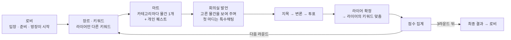
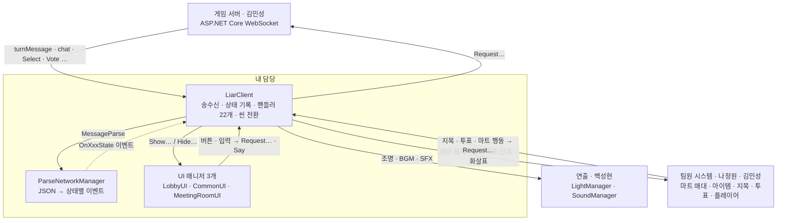
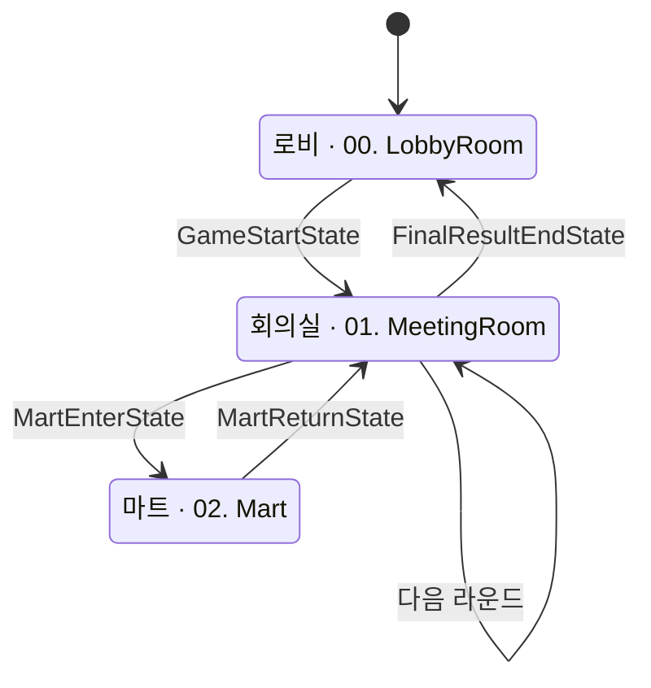
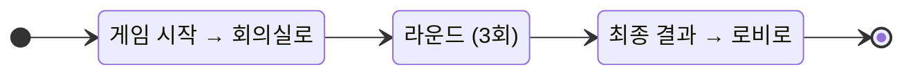
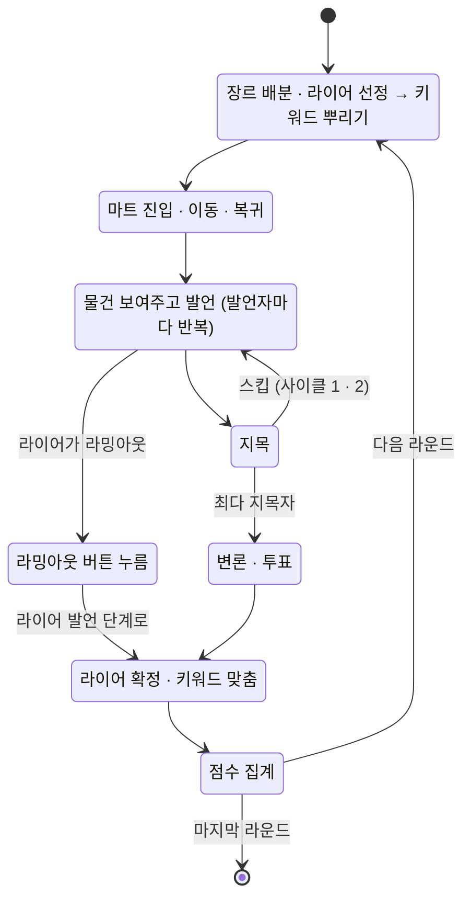
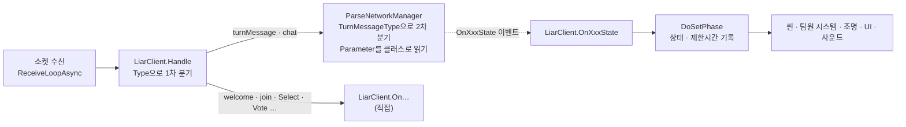
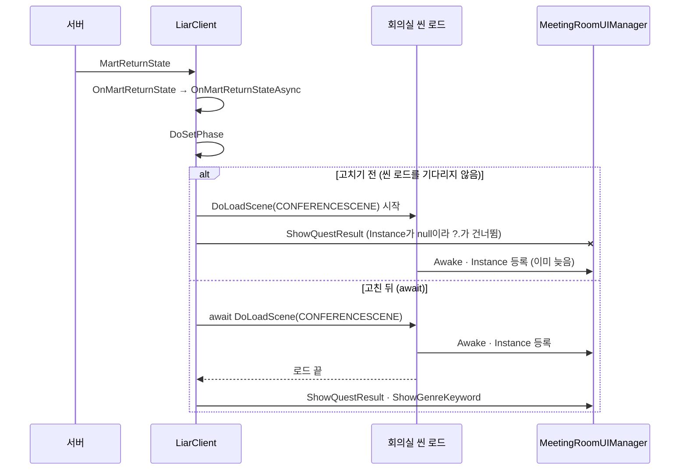
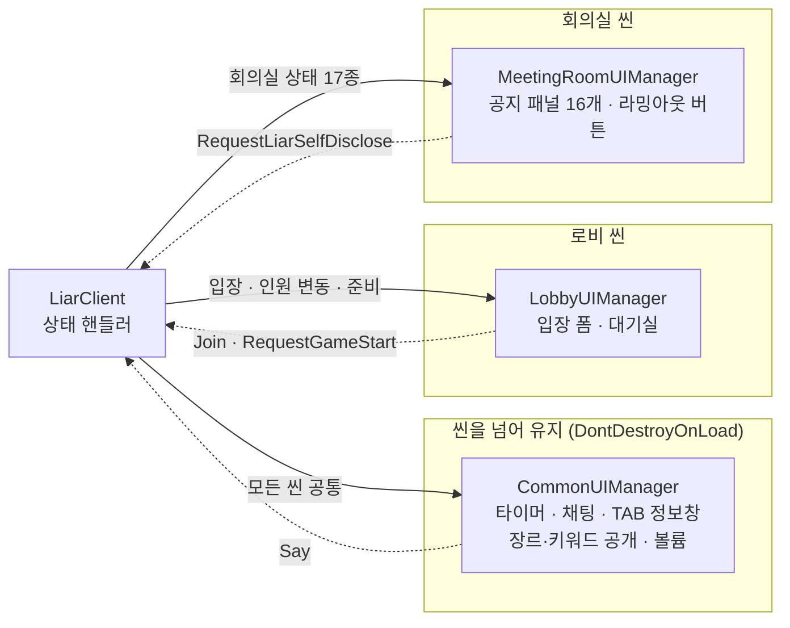
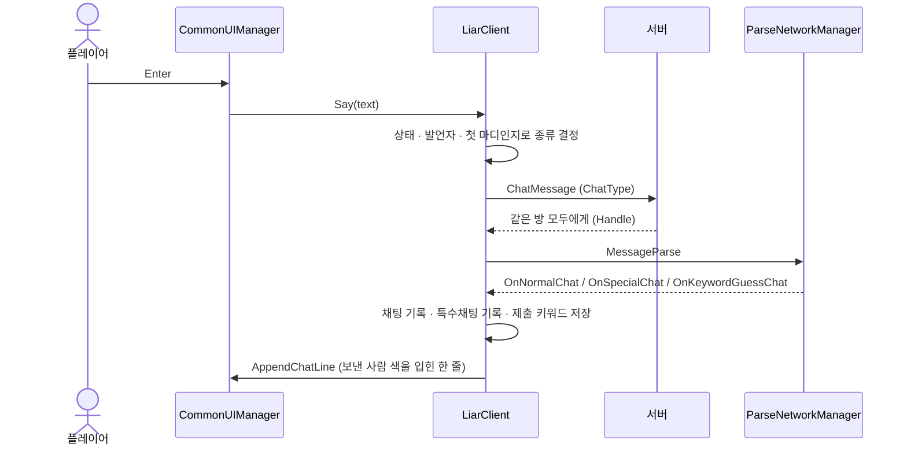

# 시장에 가면

> 마트에서 각자 물건을 골라 와 회의실에서 소개하며, 혼자 다른 키워드를 받은 **라이어**를 찾아내는 **4인 온라인 추리 게임**
>
> Unity 6 · C# · WebSocket · 4인 팀 프로젝트 (클라이언트 담당) · 2026.08.26 \~ 2026.09.10


---

## 1. 게임 소개

**시장에 가면**은 4명이 한 방에 모여 3라운드를 진행하는 온라인 라이어게임입니다.

라운드가 시작되면 모두 같은 장르와 키워드를 받는데, 단 한 명 **라이어**만 다른 키워드를 받습니다. 플레이어들은 마트에 흩어져 카테고리마다 키워드에 어울리는 물건을 하나씩 고르고, 회의실로 돌아와 차례대로 고른 물건을 보여 주며 발언합니다. 발언자의 첫 마디(특수채팅)는 기록으로 남고, 이를 근거로 라이어를 지목·투표합니다. 라이어로 확정되면 라이어는 시민의 키워드를 맞혀 역전을 노립니다. 라이어는 자기가 라이어인 줄 모르는 채로 시작하고, 발언 중에는 '내가 라이어 같다'고 추측한 사람이 누르는 '라밍아웃' 버튼도 있습니다([2장](#2-한-판의-흐름)).

| 마트: 카테고리별 물건 고르기 | 마트: 밀치기 | 회의실: 라이어 지목 |
|---|---|---|
|  |  |  |

*마트 장면(왼쪽·가운데)은 팀원 담당입니다.*

| 상황 | 입력 | 동작 |
|---|---|---|
| 로비 | 이름·방 코드 입력 → 들어가기 | 같은 방 코드를 입력한 사람끼리 모인다. 방장은 시작, 나머지는 준비 |
| 마트 | WASD | 이동 |
| 마트 | F | 물건 집기 · 내려놓기 |
| 마트 | Space | 다른 플레이어 밀치기 (물건을 든 동안은 불가) |
| 마트 | Q | 고른 물건 목록 열기 · 닫기 |
| 로비 · 회의실 | Enter | 채팅 입력창으로 이동, 입력 중이면 보내기 |
| 회의실 | TAB (누르는 동안) | 정보창: 이번 라운드 내 물건 목록, 특수채팅 기록 |
| 회의실 | 마우스 왼쪽 클릭 | 라이어로 의심되는 사람 지목 · 같은 사람을 다시 누르면 취소 |
| 회의실 | 버튼 | Skip(지목 건너뛰기) · 맞다/모르겠다/아니다(투표) · 라밍아웃 |
| 공통 | 톱니바퀴 버튼 | 설정 (BGM·SFX 볼륨, 튜토리얼) |

**참고한 게임.** 라이어 게임(파티 게임)에서 한 명만 다른 정보를 가진 채 대화로 서로를 추리하고, 지목·투표로 찾아내는 규칙을 참고했습니다. 이 프로젝트에서 다른 점은, 키워드를 말로만 설명하지 않고 **마트에서 고른 물건**을 보여 주며 설명한다는 것입니다. 라이어도 키워드를 받습니다(시민과 다를 뿐). 라이어는 자기가 라이어인 줄 모르며, 발언 중 '라밍아웃'으로 '내가 라이어다'라고 걸어 볼 수 있고, 라이어로 확정돼도 시민 키워드를 맞히면 역전합니다.

아래 두 가지는 팀장 백성현 님이 정한 게임 기획의 의도입니다.

1. 기존 라이어게임의 (키워드 받기 -> 발언 -> 지목 -> 투표 -> 결과) 라는 선형적인 구조에 마트 시스템을 추가해서 플레이어가 유리하다고 판단되는 키워드에 알맞는 아이템을 선점하거나 다른 플레이어를 밀치는 등의 상호작용으로 플레이의 다양성을 주고 싶었다.
2. 자신이 라이어인지 모르는 상태에서 자신이 라이어인지 추측하는 "라밍아웃 버튼" 이라는 특수 기믹을 통해 상황에 따라 큰 점수차를 역전할 수 있는 기회를 제공해주고 싶었다.

목표한 경험은 플레이한 사람이 끝나고 **"기존 라이어 게임보다 신선한 게임이다"** 라고 말하는 것이었습니다.

이 두 기획을 클라이언트 쪽에서 보면 이렇습니다. 마트에서 키워드에 맞는 아이템을 찾거나, 불리하더라도 퀘스트를 완료해 점수를 얻으려고 다른 아이템을 얻으면 그 정보가 실시간으로 서버에 반영됩니다. 라밍아웃 버튼을 라이어가 누르면 바로 라이어 발언 단계(라이어가 시민 키워드를 맞히는 '키워드 맞춤' 상태)로 넘어가므로 서버가 정한 라이어가 누구인지 클라이언트가 알고 있어야 합니다. 결국 클라이언트는 서버가 보낸 데이터를 올바르게 해석하는 역할을 맡습니다.

이 문서는 그중 제가 맡은 부분, 즉 서버 상태를 받아 회의실·로비 화면과 장면 사이의 흐름을 바꾸는 클라이언트 쪽에서 아래 **네 가지**의 설계·구현과 선택의 이유를 다룹니다.

**4명이 같은 순간에 같은 장면을 보며 함께 추리하도록, 서버를 따르는 클라이언트를 만들었습니다.**

이 게임의 진행은 **서버가 정하고, 클라이언트는 따라갑니다.** 서버가 다음 상태와 제한시간을 보내면 4명의 클라이언트가 같은 순간에 같은 장면으로 넘어가야 합니다. 이 흐름을 만들며 부딪힌 문제는 네 가지였습니다.

| 핵심 기능 | 부딪힌 문제 | 이렇게 풀었다 |
|---|---|---|
| [턴 메시지 처리](#5-턴-메시지-처리) | 상태 하나가 여러 곳을 바꾼다 | 단계마다 할 일을 한곳에 모아 정해진 순서로 처리한다 |
| [UI 구조 리빌딩](#6-ui-구조-리빌딩) | UI가 상태 수만큼 늘어난다 | 단계가 바뀌는 순간에만 창을 켜고 끄고, 장면마다 따로 둔다 |
| [채팅 3종 자동 판별](#7-채팅-3종-자동-판별) | 같은 입력창에서 채팅의 의미가 바뀐다 | 입력창은 하나, 어떤 채팅인지는 지금 단계와 말하는 사람으로 정한다 |
| [조명·사운드 연출 연결](#8-조명사운드-연출-연결) | 지금 누가 주인공인지 보여야 한다 | 단계가 바뀔 때 주인공을 비추는 조명과 소리도 함께 바꾼다 |

기술 목표는 **개발 마감(09.10)까지 3라운드 한 판이 끝까지 돌고, 서버 프로토콜(서버와 클라이언트가 주고받는 메시지의 양식)이 바뀌어도 클라이언트가 따라갈 수 있는 구조**를 만드는 것이었습니다.

| 항목 | 내용 |
|---|---|
| 엔진 · 언어 | Unity 6 (6000.3.15f1), URP · C# |
| 주요 패키지 | UniTask(기다리는 동안 게임을 멈추지 않는 비동기 처리), Newtonsoft.Json(`com.unity.nuget.newtonsoft-json`), DOTween, uGUI + TextMeshPro, Input System |
| 서버 | ASP.NET Core WebSocket 서버 (김민성 님 작성, 별도 저장소) |
| 공용 코드 | `SingletonBase<T>`, `SimpleInput`(Input System 래퍼), WebSocket 예제 `RoomClient`(접속·수신 루프·전송 잠금): 강의 저장소의 코드. `LiarClient`는 `RoomClient`를 바탕으로 라이어게임 메시지 처리를 더한 것 |
| 협업 도구 | GitHub 조직 저장소, Fork(Git 클라이언트), Asana, JetBrains Rider |
| 기간 | 2026.08.26 \~ 2026.09.10 (마감 09.10) · 그 전 08.22 \~ 08.25는 준비 기간 |
| 규모 | 담당 스크립트 7개 약 3,500줄 중 본인 작성 약 2,500줄 (현재 코드의 줄별 작성자 기준. 서버 프로토콜에 맞춘 `Protocol.cs`·`CreateNetworkManager.cs` 약 700줄 포함. 이 중 `Protocol.cs`는 서버 정의를 옮긴 것이고, `CreateNetworkManager.cs`의 턴 메시지 생성 부분은 서버 코드를 그대로 가져온 것) |

- GitHub: https://github.com/rlawlsdn77/Unity-3D-IfIWasInMarket (내 코드는 `Assets/10. Scripts/06. Server And WebSocket/KJW_LIARGAME/Scripts`)
<!-- ✍️ 시연 영상이 생기면 이 자리에 "- 시연 영상: <주소>" 줄을 추가. '(추가 예정)' 같은 빈 자리표시자는 읽는 사람에게 '링크 없음'과 같아서 뺐습니다 -->

---

## 2. 한 판의 흐름

| 00. LobbyRoom | 02. Mart | 01. MeetingRoom |
|---|---|---|
|  |  |  |
| 방 입장, 대기, 준비·시작, 최종 결과 뒤 복귀 · 내가 만든 UI: `LobbyUIManager` + 공통 UI(채팅) | 물건 고르기, 개인 퀘스트, 밀치기 · 내가 만든 UI: 공통 UI(타이머·설정)만. 마트 UI는 팀원 담당 | 장르·키워드 공개, 발언, 지목, 변론, 투표, 라이어 확정, 점수, 최종 결과 · 내가 만든 UI: `MeetingRoomUIManager` + 공통 UI(타이머·채팅·TAB 정보창) |

한 판은 아래 고리를 3라운드 되풀이합니다.



발언은 카테고리마다 한 바퀴(사이클)씩, 한 라운드에 3사이클 돕니다. 사이클 1·2의 지목은 건너뛸 수 있어 다음 카테고리 발언으로 넘어가고, 마지막 사이클은 반드시 지목해야 합니다. 발언 중에는 모두에게 '라밍아웃' 버튼이 보입니다. 라이어가 누르면 정체가 모두에게 공개되고 바로 라이어 발언 단계(키워드 맞춤)로 넘어갑니다. 라이어가 아닌 사람이 누르면 본인에게만 "당신은 라이어가 아닙니다"가 뜨고 턴은 그대로 이어지며, 깎인 점수는 점수 집계 때 적용됩니다. 점수는 투표 성공, 라이어의 키워드 맞춤, 라밍아웃, 개인 퀘스트 성공 여부를 서버가 합산합니다.


*1라운드(약 5분)를 4초마다 한 장씩 10초로 빨리 감았습니다.*

키워드와 직접 연관된 아이템이 나올 확률은 낮지만, 계속되는 발언 단계의 추론을 통해 각 플레이어의 발언 스타일을 학습해 참·거짓을 유추할 수 있습니다. (기존 라이어 게임과 다른 점은 [1장](#1-게임-소개) 참고한 게임)

---

## 3. 팀 구성과 내 담당

**팀 구성과 역할**

| 팀원 | 맡은 부분 |
|---|---|
| 백성현 | 회의실·마트 맵, UI 디자인(로비·공통·회의실·마트 UI 리소스와 배치), `LightManager`·`SoundManager`, 타이틀·튜토리얼, `main` 병합 |
| 김민성 | 게임 서버(ASP.NET Core WebSocket)와 턴 메시지 프로토콜, 장르·키워드·아이템 데이터 테이블, 마트 매대·아이템 배치, 준비(Ready) 기능 |
| 나정원 | 캐릭터 이동·애니메이션, 아이템 집기·내려놓기·밀치기와 서버 연동, 지목 화살표·투표 시스템, 플레이어 색상 |
| **김진우 (본인)** | **라이어게임 클라이언트**: 턴 상태 처리(`LiarClient`), 로비·공통·회의실 UI, 채팅, 턴별 조명·사운드 연결 |

GitHub 조직 저장소에 사람별 작업 브랜치를 올리고 Git 클라이언트 Fork로 병합·충돌을 처리했으며, 할 일과 진행 상황은 Asana 카드로 나눴습니다. 협업 과정의 문제는 [10장](#10-협업과-병합)에서 다룹니다.

**내 담당 범위**

| 구분 | 내가 한 것 | 팀원 작업과의 경계 |
|---|---|---|
| 네트워크 | 라이어게임 메시지 처리: 턴 상태 22종 핸들러(그 상태를 받았을 때 할 일을 모아 둔 함수), 채팅 3종, 방장·게임 시작, 씬 전환 흐름, 서버 프로토콜 변경에 맞춘 클라이언트 리팩터링 | 서버와 프로토콜 설계는 김민성 님. WebSocket 접속·수신 루프·전송 잠금은 수업 예제 `RoomClient`를 바탕으로 함 |
| UI | 로비·공통·회의실 UI 매니저 3개와 상태별 공지 패널 | UI 이미지·배치 디자인은 백성현 님. 마트 UI는 나정원·백성현 님 |
| 연출 | 조명의 크기·색·개수·위치 조정과 턴에 맞는 조명 배치, 턴 상태에 맞춘 조명 전환(DOTween)·BGM·SFX 연결, 볼륨 조절 | `LightManager`의 조명 켜고 끄기 기능과 `SoundManager` 본체(오디오 소스 구성)는 백성현 님 |
| 마트·지목·투표 | 상태가 바뀔 때 해당 시스템을 부르는 연결 (매대 배치 대기, 지목·투표 단계 전환, 스킵 버튼) | 시스템 자체는 김민성·나정원 님 |

**언제 무엇을 했나**

| 기간 | 작업 |
|---|---|
| 08.22 \~ 08.25 (준비 기간) | 매대 프리팹, 타이틀·방 만들기·방 입장 씬과 회의실 UI 시안 (이후 방 코드 입장 방식으로 대체) |
| 08.25 \~ 08.29 | 라이어게임 메시지 클래스, 방장·게임 시작, 씬 전환(로비 → 마트 → 회의실), 특수채팅 판별, 남은 시간 표시 |
| 08.30 \~ 09.02 | OnGUI → Canvas 프리팹, 라밍아웃·점수·우승자, 3라운드 루프 완성 |
| 09.02 \~ 09.05 | 서버 프로토콜(`TurnMessage`) 기준 리팩터링, 씬별 UI 매니저로 재구성 |
| 09.06 \~ 09.10 | 조명(DOTween)·사운드 연결, 볼륨, 승패 애니메이션, 버그 수정 |


---

## 4. 전체 구조



> 실선은 직접 호출, 점선은 이벤트(구독한 쪽이 받음)입니다. 서버와 주고받는 길은 `LiarClient` 하나뿐이고, UI·연출·팀원 시스템은 서버를 직접 알지 않습니다.

구조 전체를 관통하는 규칙은 네 가지입니다.

1. **On · Do · Request로 나눈다.** `LiarClient`의 함수는 서버에서 온 것을 처리하는 `On…`, 클라이언트 안에서 처리하는 `Do…`, 서버로 보내는 `Request…` 셋 중 하나다 (08.28부터). → [5.2](#52-상태-하나에-핸들러-하나)
2. **진행은 서버가 정하고, 상태 값은 한 곳에서만 쓴다.** 현재 상태·제한시간·사이클·라운드는 `{ get; private set; }`이고, 쓰는 곳은 `DoSetPhase` 하나다. 클라이언트는 다음 상태를 스스로 정하지 않는다. → [5.4](#54-상태는-한-곳에서만-기록한다)
3. **UI는 상태가 바뀌는 순간에만 부른다.** 매 프레임 읽는 것은 시간·입력에 따라 변하는 것(타이머, TAB, 라밍아웃 버튼의 '남은 3초' 조건)뿐이다. → [6장](#6-ui-구조-리빌딩)
4. **연출은 서버가 확정한 순간에 붙인다.** 조명·BGM·SFX는 로컬 입력이 아니라 서버 메시지 핸들러에서 부른다. 4명이 같은 순간에 같은 연출을 본다. → [8장](#8-조명사운드-연출-연결)

| 클래스 | 책임 | 작성 |
|---|---|---|
| `LiarClient` | 소켓 송수신, 서버 상태 기록(`CurrentState` 등), 상태별 핸들러 22개, 씬 전환, UI·연출·팀원 시스템 호출 | 본인 (마트 응답·플레이어 배치는 나정원 님, 준비는 김민성 님) |
| `ParseNetworkManager` | 받은 `TurnMessage`·`ChatMessage`·`UserInteractionMessage`를 종류별로 나눠 정적 이벤트(`Action`) 호출 | AI 작성(09.02, 본인이 읽고 확인), 이후 나정원 님과 함께 갱신 |
| `CreateNetworkManager` | 보낼 메시지 생성 (채팅 3종, 마트 상호작용). 턴 메시지 생성기(`TurnMessageFactory`)도 들어 있지만 클라이언트는 쓰지 않음 | 채팅·마트 상호작용은 본인 (서버 프로토콜 기준). `TurnMessageFactory`는 서버 코드를 그대로 가져옴 |
| `Protocol` | 서버와 주고받는 메시지 클래스 | 서버 정의를 클라이언트로 옮김 |
| `LobbyUIManager` | 입장 폼, 대기실(방 정보·준비·시작 버튼) | 본인 (준비 인원 표시는 김민성 님) |
| `CommonUIManager` | 타이머, 채팅, TAB 정보창, 장르·키워드 공개, 볼륨 패널. 씬을 넘어 유지 | 본인 (튜토리얼 페이지는 백성현 님) |
| `MeetingRoomUIManager` | 회의실 공지 패널 16개, 라밍아웃 버튼, 점수 목록 | 본인 |
| `LightManager` | 스포트라이트 위치·밝기·색 | 조명 켜고 끄기는 백성현 님. 조명의 크기·색·개수·위치 조정과 DOTween 전환·테이블·라이어·우승자 조명은 본인 |
| `SoundManager` | BGM 7종·SFX 15종 재생, 볼륨 | 백성현 님 (볼륨 조절은 본인 추가) |
| `Vote_System`, `ConferenceManager`, `DisplayStandManager`, `MartManager` 등 | 지목·투표 입력, 화살표, 매대 배치, 마트 UI | 나정원·김민성·백성현 님 |

씬은 서버가 보낸 상태에 따라 아래처럼 바뀝니다.



- 씬 전환은 `LiarClient.DoLoadScene` 한 곳에서만 합니다. 새 씬을 Additive(지금 씬을 두고 겹쳐 불러오는 방식)로 불러 활성 씬으로 바꾼 뒤 이전 씬을 내립니다. 씬을 넘어 남는 객체를 정한 과정은 [5.5](#55-씬이-바뀌어도-통신은-남기고-ui는-로드-뒤에)에 있습니다.
- 라운드가 바뀔 때는 로비를 거치지 않고 회의실에서 바로 다음 장르·키워드를 받습니다 (09.06부터).

---

## 5. 턴 메시지 처리

기존 라이어 게임에 없는 마트 단계와 회의실 단계를 씬 전환으로 잇는 흐름을 만듭니다.

### 5.1 상태 하나가 여러 곳을 바꾼다

**문제.** 게임의 진행은 서버가 정합니다. 서버는 상태가 바뀔 때마다 "지금은 이 상태, 제한시간은 N ms"를 4명 모두에게 보내고, 클라이언트는 받은 순간 그 상태에 맞는 화면으로 넘어가야 합니다. 상태는 22종이고, 하나를 받으면 할 일이 여러 가지입니다.

| 받은 상태 (예) | 클라이언트가 할 일 |
|---|---|
| `MartReturnState` (마트에서 복귀) | 손에 든 물건 정리 → 유저별 고른 물건·퀘스트 결과 저장 → 회의실 씬 로드 → 채팅·TAB 정보창·퀘스트 결과·장르/키워드 UI → 퀘스트 SFX → 회의 BGM |
| `PointAtSuspectState` (지목) | 투표 시스템을 지목 단계로 → 스킵 버튼(마지막 사이클 제외) → 테이블 조명 → 지목 안내 → 지목·투표 BGM |
| `FinalResultState` (최종 결과) | 우승자 목록 저장 → 플레이어마다 승리/패배 애니메이션 → 테이블 조명 → 승패 UI → 승리/패배 BGM |

턴 상태는 서버가 보낸 차례대로 아래처럼 넘어갑니다.



<!-- ✍️ 둘째 그림 앞 한 줄: '라운드 (3회)' 안에서 무엇을 보면 되는지 직접 쓰기 (11.22 답: 그림을 둘로 나누기 — 바깥 흐름 / 라운드 안 흐름) -->



### 5.2 상태 하나에 핸들러 하나

핸들러는 모두 같은 순서를 따릅니다. **① `DoSetPhase`로 공통 값 기록 → ② 팀원 시스템 → ③ 조명 → ④ UI → ⑤ 사운드.** 5.1 표의 예시가 모두 이 순서입니다.


```csharp
// LiarClient.cs — 지목 상태. 이 상태가 할 일을 정해진 순서로 부른다
private void OnPointAtSuspectState(float timerMs, int cycle, int round)
{
    DoSetPhase(TurnMessageType.PointAtSuspectState, timerMs, cycle, round);      // ① 공통 값 기록

    Vote_System.Instance?.SetTurnType(Vote_System.TurnType.Point, timerMs);      // ② 팀원 시스템: 지목 입력 켜기
    if (cycle != 3) ConferenceManager.Instance?.RequestSkipPointUI(true);         //    스킵 버튼 (마지막 사이클 제외, 하드코딩 → 11장)

    LightManager.Instance?.TurnOnFocusTable();                                     // ③ 조명: 테이블 전체
    MeetingRoomUIManager.Instance?.ShowPointAtNotice();                            // ④ UI: "라이어로 의심되는 사람을 지목하십시오"

    SoundManager.Instance?.StopBGM();                                              // ⑤ 사운드: 지목·투표 BGM
    SoundManager.Instance?.PlayBGM(SoundManager.GameBGM.LiarGameVoteOrPoint);
}
```

### 5.3 턴 메시지를 하나로 묶고, 너그럽게 읽는다

**처음 구조와 바뀐 계기.** 처음(\~09.01)에는 상태마다 메시지 클래스가 따로 있었고(22개), 종류(`Type`)가 `"게임 시작 상태"` 같은 한글 문자열이었습니다. 받는 쪽 `switch`에는 문자열 `case`가 34개 있었습니다. 09.02에 서버를 맡은 김민성 님이 턴 메시지를 보내는 기능을 넓히기에 지금 구조가 어렵다며 대대적인 리팩터링을 제안했고, 저는 턴 상태를 `TurnMessage` 하나로 통합하는 방향을 골랐습니다(이유는 아래 비교). 서버가 이 구조로 바뀐 뒤 클라이언트를 맞춰 다시 짰습니다. `Handle` 분기 정리, 핸들러 22개의 인자 변경, 구독 연결은 직접 했고, 2차 분기를 맡는 `ParseNetworkManager`는 AI에게 맡긴 뒤 읽고 확인했습니다([AI와 함께 만든 방식](#ai와-함께-만든-방식)).

```csharp
// 09.01까지 — LiarClient.Handle에 상태마다 한글 문자열 case가 하나씩 (턴 상태만 22줄)
case "게임 시작 상태": OnGameStartState(JsonConvert.DeserializeObject<GameStartStateMessage>(json)); break;
case "키워드 뿌리기 상태": OnKeywordDistributeState(JsonConvert.DeserializeObject<KeywordDistributeStateMessage>(json)); break;
// …
```

**늘어나는 턴 메시지를 어떻게 나눠 받을까? (09.02)**

| | A. 테이블 기반 매칭 (규칙·조건 표) | B. 턴 상태를 `TurnMessage` 하나로 통합하고, 상태 종류(`TurnMessageType` enum)로 나눈다 (09.02 \~) |
|---|---|---|
| 방식 | (조건 판별 함수 또는 파라미터 매처, 실행 핸들러) 쌍을 리스트나 배열로 두고, 들어온 메시지나 파라미터를 순서대로 맞춰 보아 처음 맞는 핸들러를 실행한다 | 모든 턴 메시지가 상태 종류와 공통 값(`TimerMs`·사이클·라운드)을 같은 모양으로 갖고, 상태별 값만 `Parameter`로 따로 읽는다 |
| 장점 | 상태 이름 하나가 아니라 값의 조합(예: 특정 파라미터가 있을 때)으로도 핸들러를 고를 수 있다 | 아래 [결정] |
| 단점 | 어느 메시지가 어느 핸들러로 가는지 조건 함수를 하나하나 읽어야 안다 | `ParseNetworkManager`에 case가 22개, `Action` 필드가 상태 수만큼 생긴다. 서버와 클라이언트의 `TurnMessageType` 이름·순서가 어긋나면 엉뚱한 상태로 읽힌다 |

**[결정] 대안 B.** 턴 메시지가 앞으로 더 늘어날 수 있다고 봤기 때문입니다. 서버가 보내는 `TurnMessageType` 이름 그대로 나누므로 서버 코드와 한 줄씩 맞춰 볼 수 있고, 모든 상태가 `TimerMs`·사이클·라운드를 같은 자리에 갖고 `DoSetPhase` 한 곳에서 기록됩니다.

| | 09.01까지 | 09.02부터 |
|---|---|---|
| 턴 상태 메시지 | 상태마다 클래스 22개 (`GameStartStateMessage` …) | `TurnMessage` 하나 = `TurnMessageType`(enum 22개) + 공통 값(`TimerMs`·사이클·라운드) + `Parameter`(JSON 문자열) |
| 상태별 값 | 클래스마다 필드 | 값이 있는 상태만 파라미터 클래스 (10개). 예: `FocusIdParameter` 하나를 지목 종료·라이어 확정·라밍아웃 3곳이 함께 쓴다 |
| 받는 쪽 분기 | `Handle`의 한글 문자열 `case` 34개 | `Handle`은 메시지 종류 14개만, 턴 상태는 `ParseNetworkManager`가 enum으로 분기 |
| 핸들러가 받는 것 | 메시지 객체 통째로 | 공통 값 + 그 상태에 필요한 값만 (`Action<float, int, int, …>`) |

**구조.** 받은 메시지는 두 번 나뉩니다. `LiarClient.Handle`이 메시지 종류(`Type`)로 한 번, `ParseNetworkManager`가 턴 상태 종류(`TurnMessageType`)로 한 번입니다.



```csharp
// 09.02부터 — LiarClient.Handle은 종류만 보고 넘긴다
case "turnMessage":
    ParseNetworkManager.NetworkManager.MessageParse(JsonConvert.DeserializeObject<TurnMessage>(json));
    break;
```

```csharp
// ParseNetworkManager — 상태 종류로 나누고, 값이 있는 상태만 Parameter를 해당 클래스로 읽어 이벤트로 넘긴다
case Protocol.TurnMessageType.ShowItemAndSpeakState:
{
    var p = Parse<Protocol.ShowItemAndSpeakParameter>(msg.Parameter);
    OnShowItemAndSpeakState?.Invoke(msg.TimerMs, msg.CurrentCycle, msg.CurrentRound,
        p.CurrentFocusID, p.CurrentCategory);
    break;
}
```

- 핸들러는 메시지 객체가 아니라 **필요한 값만** 받습니다. 발언 상태 핸들러는 `(타이머, 사이클, 라운드, 발언자 ID, 카테고리)`를 받으므로, 프로토콜 클래스가 바뀌어도 고칠 곳은 `ParseNetworkManager` 한 곳입니다.
- 새 상태를 추가하는 비용이 'enum 값 1 + case 1 + 핸들러 1'로 정해졌습니다.

**서버와 다른 JSON 라이브러리를 쓸까? (09.02)**

| | A. 서버와 같은 System.Text.Json | B. 클라이언트는 Newtonsoft.Json (Unity 공식 패키지) |
|---|---|---|
| 장점 | 서버와 같은 규칙으로 읽고 쓴다. 서버의 프로토콜 정의를 그대로 가져올 수 있다 | 받는 데이터를 유연하게 파싱한다. 옵션 없이도 속성 이름의 대소문자를 가리지 않고, enum을 숫자로든 이름 문자열로든 읽고, 숫자 ↔ 문자열처럼 기본형이 달라도 바꿔 넣는다. Unity 패키지 매니저로 관리되고, 수업 예제 `RoomClient`도 이미 쓰고 있었다 |
| 단점 | 기본값이 엄격하다. 속성 이름은 대소문자까지 같아야 하고(다르면 오류 없이 빈 값으로 남는다), enum은 숫자로만 읽고, 숫자·문자열은 형식이 정확히 맞아야 한다. 너그럽게 읽으려면 호출할 때마다 옵션(`PropertyNameCaseInsensitive`, `JsonStringEnumConverter`, `NumberHandling`)을 넘겨야 한다. Unity에 기본으로 없어 NuGet 패키지도 직접 넣어야 한다(09.02에 설치해 보니 의존 패키지만 9개) | 너그럽게 읽어 주는 만큼, 서버 쪽 이름·형식이 어긋나도 클라이언트에서는 오류 없이 지나가 늦게 발견될 수 있다. 서버 프로토콜이 바뀔 때마다 직렬화 호출(`JsonSerializer` → `JsonConvert`)을 바꿔 옮겨 적어야 한다 |

**[결정] 대안 B.** 클라이언트는 서버가 보내는 여러 모양의 메시지를 받아 읽는 쪽이라, 엄격하게 읽기보다 유연하게 파싱하는 쪽이 맞다고 판단했습니다. 이 프로토콜은 사용자 ID 하나에도 `ID`·`Id`·`UserID`·`UserId`·`senderId`처럼 표기가 다섯 가지로 섞여 있어, 서버나 클라이언트 한쪽에서 대소문자만 달라져도 System.Text.Json 기본값이면 값이 조용히 빠집니다. 턴 상태·채팅 종류·상호작용 종류는 enum으로 오가는데, Newtonsoft는 숫자로 오든 이름으로 오든 읽습니다.

덕분에 턴 메시지 하나를 '종류(`Type`)만 먼저 읽기 → `TurnMessage`로 다시 읽기 → `Parameter` 문자열을 파라미터 클래스로 읽기'로 세 번 파싱하는 구조를, 옵션 없이 `JsonConvert.DeserializeObject<T>(json)` 한 줄씩으로 유지할 수 있었습니다. 설치해 보았던 System.Text.Json은 바로 지웠지만, 함께 들어온 의존 패키지 9개가 남아 [11장 아쉬운 점](#아쉬운-점과-향후-계획)에 정리 과제로 남겼습니다.

### 5.4 상태는 한 곳에서만 기록한다

```csharp
// LiarClient.cs (발췌) — 서버가 보낸 상태는 여기서만 기록한다. 밖에서는 읽기만
public TurnMessageType? CurrentState { get; private set; } = null;
public float TimerMs { get; private set; }
public string CurrentOwnerID { get; private set; } = "";
private float phaseStartTime;   // TimerMs를 받은 그 때의 시간

// 지금 상태에서 남은 시간(초)
public float RemainingSeconds => Mathf.Max(0f, TimerMs / 1000f - (Time.time - phaseStartTime));

private void DoSetPhase(TurnMessageType type, float timerMs, int currentCycle, int currentRound,
    string currentOwnerID = "")
{
    CurrentState = type;
    TimerMs = timerMs;
    CurrentCycle = currentCycle;
    CurrentRound = currentRound;
    CurrentOwnerID = currentOwnerID;
    phaseStartTime = Time.time;
}
```

- 모든 핸들러가 `DoSetPhase`로 시작하므로, "지금 무슨 상태인가"를 바꾸는 길이 하나뿐입니다. `Say`의 채팅 판별과 라밍아웃 버튼 조건이 모두 이 값을 읽습니다.
- 서버는 제한시간을 상태가 시작될 때 한 번만 보냅니다. 클라이언트는 받은 시각을 기억해 남은 시간을 직접 계산하므로, 매초 시간을 주고받지 않습니다.
- 대가로, 클라이언트마다 메시지를 받은 시각 기준이라 네트워크 지연만큼 표시가 조금씩 어긋납니다. 진행은 서버 시간으로 하므로 표시만 다릅니다.

### 5.5 씬이 바뀌어도 통신은 남기고, UI는 로드 뒤에

**씬이 바뀌어도 `LiarClient`를 어떻게 살려 둘까? (08.28)**

| | A. 로비 씬을 계속 띄워 두고, 마트·회의실 씬만 그 위에 Additive로 얹는다 (08.28 첫 구현) | B. `LiarClient`를 `DontDestroyOnLoad`로 씬 밖에 두고, 모든 씬을 같은 방식으로 바꾼다 (같은 날 변경) |
|---|---|---|
| 장점 | `DontDestroyOnLoad` 없이 `LiarClient`가 로비 씬에 그대로 있다 | 로비도 다른 씬과 똑같이 '새 씬 로드 → 활성 씬 지정 → 이전 씬 내리기'로 처리된다. 예외 규칙이 사라진다 |
| 단점 | `LiarClient`가 로비 씬 안에 있어 로비 씬을 내릴 수 없다. 로비의 다른 오브젝트를 하나하나 꺼서 숨기는 처리(`DoHideScene`)가 따로 필요하고, '로비에서 나갈 때'만 다른 규칙이 생긴다 | 씬에 있는 플레이어·매니저를 씬이 바뀔 때마다 다시 찾아 연결해야 한다. 씬을 넘어 사는 객체가 사라진 씬의 객체를 붙잡고 있지 않도록 신경 써야 한다 |

**[결정] 대안 B.** 첫 구현의 주석("로비는 내릴 수 없으니(이 오브젝트 자신이 그 안에 있음)")처럼, 로비만 내릴 수 없다는 예외가 씬 전환 코드에 남는 것보다 살아남는 객체를 `LiarClient`·`CommonUIManager`·`SoundManager`로 한정하고 나머지를 씬과 함께 버리는 쪽이 단순했습니다. 대가인 재연결은 씬 로드가 끝난 뒤 한 곳(현재 `DoResponseAll`)에서 처리하고, 씬 UI 매니저는 `OnDestroy`에서 `Instance`를 비워 사라진 UI를 부르지 않게 했습니다.

`DoLoadScene`은 새 씬 Additive 로드 → 활성 씬 지정 → 이전 씬 언로드 → 플레이어 재배치 순서로 씬을 바꾸고, 이미 그 씬이면 바로 돌아옵니다. 구조는 본인(08.28), `await`할 수 있게 바꾼 것은 나정원 님(09.03) 작업입니다.

```csharp
// LiarClient.cs (발췌) — 이벤트가 부르는 핸들러는 void로 두고, 실제 처리는 async UniTask에 맡긴다
private void OnMartReturnState(float timerMs, int cycle, int round,
    UserItemList[] userItemLists, UserQuestInfo[] userQuestInfos)
{
    OnMartReturnStateAsync(timerMs, cycle, round, userItemLists, userQuestInfos).Forget();
}
```

- 씬을 옮기는 상태 4종(게임 시작, 마트 진입, 마트 복귀, 최종 결과 종료)이 모두 이 모양입니다. `async void`와 달리 필요하면 기다리거나 예외를 받을 수 있고, 기다리지 않는 곳은 `.Forget()`으로 '일부러 기다리지 않는다'를 표시합니다. 게임 시작 핸들러에는 이 표시가 빠져 있습니다([11장 아쉬운 점](#아쉬운-점과-향후-계획)).

```csharp
// LiarClient.cs (발췌)
private async UniTask OnMartReturnStateAsync(float timerMs, int cycle, int round,
    UserItemList[] userItemLists, UserQuestInfo[] userQuestInfos)
{
    DoSetPhase(TurnMessageType.MartReturnState, timerMs, cycle, round);
    // … 손에 든 물건 정리, 퀘스트 결과·유저별 고른 물건 저장, 플레이어를 회의실 상태로

    await DoLoadScene(CONFERENCESCENE);     // 회의실 씬과 MeetingRoomUIManager가 준비될 때까지 기다린다

    CommonUIManager.Instance?.ShowChat();
    CommonUIManager.Instance?.EnableTabInfo();
    MeetingRoomUIManager.Instance?.ShowQuestResult(QuestSuccess);   // 이제 회의실 UI가 있다
    MeetingRoomUIManager.Instance?.ShowGenreKeyword(Genre, Keyword);
    // … 퀘스트 SFX, 회의 BGM
}
```

- 회의실 UI는 회의실 씬에 있으므로, 씬 로드를 기다리지 않고 부르면 `Instance`가 null이라 `?.`가 호출을 조용히 건너뜁니다. 그래서 `await DoLoadScene` 다음에 부릅니다 ([5.6](#56-는-조용히-건너뛴다)).

### 5.6 `?.`는 조용히 건너뛴다

*09.05 → 09.06*

- **문제.** 마트 복귀 상태에 들어오자마자 퀘스트 결과와 장르·키워드를 회의실에 띄워야 하는데, 이 상태는 씬 전환과 동시에 시작돼 부르는 시점에 회의실 UI가 아직 없었습니다.
- **원인.** 씬 로드는 비동기입니다. 핸들러가 UI를 부를 때는 아직 마트 씬이라 `MeetingRoomUIManager.Instance`가 null이었고, `?.`가 호출을 오류 없이 건너뛰었습니다.
- **해결.** 핸들러를 비동기로 감싸 `await DoLoadScene` 뒤에 UI를 부르게 했습니다([5.5](#55-씬이-바뀌어도-통신은-남기고-ui는-로드-뒤에)). 처음엔 `async void`로 감쌌다가(09.05), 마트 진입 등 다른 씬 전환 핸들러와 같은 `async UniTask` + `.Forget()` 구조로 맞췄습니다(09.06).
- **결과.** 고친 뒤 테스트에서, 마트에서 돌아오자마자 퀘스트 결과와 장르·키워드가 회의실에 뜨는 것을 확인했습니다.
- **남은 것.** 이 방법은 **같은 핸들러 안의 순서**만 보장합니다. 씬 로드 중에 다음 상태 메시지가 먼저 도착하면 그 핸들러의 UI 호출은 여전히 건너뛰어질 수 있습니다. 지금은 상태 사이 간격 덕분에 드러나지 않을 뿐이라 11장 아쉬운 점에 남겼습니다.

고치기 전에는 `ShowQuestResult`가 `Instance` 등록보다 먼저, 고친 뒤에는 등록 다음에 옵니다.



### 5.7 예외 상황

| 상황 | 처리 |
|---|---|
| 서버가 클라이언트가 모르는 `Type`을 보냄 | `default`에서 로그만 남기고 넘어간다 |
| 파라미터가 없는 상태 | `Parameter`가 비어 있으면 읽지 않고 공통 값만 넘긴다 |
| 서버가 꺼져 있음 · 접속 실패 | 경고 로그 후 `IsBusy`를 풀어 다시 '들어가기'를 누를 수 있게 한다 |
| 같은 씬을 다시 부름 | `DoLoadScene`이 바로 돌아온다 |
| 씬 로드 전에 그 씬의 UI를 부름 | 씬을 옮기는 핸들러는 `await DoLoadScene` 뒤에 부른다. 매니저가 없으면 `?.`로 건너뛴다 |
| 방장이 아닌 사람이 시작 요청 | `RequestGameStart`가 보내지 않는다 (`IsHost`) |
| 파괴된 객체의 함수가 불림 | `SubAllEvents`가 `Awake`에서 이벤트 29개를 구독하고, `UnSubAllEvents`가 `OnDestroy`에서 같은 순서로 해제한다. 정적 이벤트라 해제하지 않으면 파괴된 객체의 함수가 불린다 |

---

## 6. UI 구조 리빌딩

상태가 바뀌는 순간 공지 패널이 떠서, 새 규칙(마트·특수채팅·라밍아웃)이 낯선 사람도 지금 무엇을 할지 압니다.

### 6.1 UI가 상태 수만큼 늘어난다

**문제.** 라이어게임의 UI는 거의 전부 '지금 상태'에 따라 켜지고 꺼집니다. 회의실 공지 패널만 16개이고, 몇몇은 두 상태에 걸쳐 보여야 합니다(점수 목록: 키워드 맞춤 종료 \~ 점수 집계, 라밍아웃 결과: 발언자 공지 위에 겹쳐서). UI 구조는 두 번 바뀌었습니다.

| 시기 | 방식 | 한계 |
|---|---|---|
| \~ 08.29 | `LiarLobby`의 `OnGUI`: 코드 좌표로 박스·버튼·채팅을 그림 | 인스펙터에서 배치하거나 UI 이미지를 입힐 수 없다 |
| 08.30 \~ 09.04 | `LiarUICanvasBinder` 1개: Canvas 프리팹 하나에 모든 UI. `Update`에서 갱신 함수 12개가 매 프레임 돌고, 그중 9개가 `CurrentState`를 비교 | 로비용 방 정보·채팅이 마트·회의실에서도 계속 보였다. 두 상태에 걸친 패널은 조건식이 길어졌다(6.3). 바뀌지 않은 글자도 매 프레임 새 문자열로 다시 넣었다 |
| 09.05 \~ | 씬별 UI 매니저 3개. 상태 핸들러가 진입 순간 `Show…`를 직접 호출. `Update`에는 시간·입력에 따라 변하는 것만 | — |

**UI를 어떻게 묶을까?**

| | A. Canvas 하나에 모든 씬의 UI | B. 씬별 UI 매니저 + 공통 UI만 씬을 넘어 유지 |
|---|---|---|
| 장점 | 프리팹 하나만 관리한다. 씬 전환과 무관하게 항상 있다 | 씬 UI는 씬과 함께 생기고 사라져 '이 씬이 아니면 끄기'가 필요 없다 |
| 단점 | 로비 UI가 마트·회의실에서도 보여, 씬마다 끄는 조건이 필요하다 (바인더 주석: "아직 씬별로 분리되지 않아서 마트/회의실에서도 계속 보임") | 어느 UI가 어느 씬에 있는지 알아야 부를 수 있다. 씬에 없는 매니저를 부르면 `?.`로 건너뛰어, 오류 없이 조용히 사라진다 |

**[결정] 대안 B.** 타이머·채팅처럼 장면을 넘어 이어져야 하는 것만 공통으로 두고, 나머지는 쓰는 씬에 넣었습니다. 대가인 '조용한 실패'는 씬을 옮기는 상태에서 반드시 씬 로드를 기다린 뒤 UI를 부르는 규칙으로 막았습니다 ([5.5](#55-씬이-바뀌어도-통신은-남기고-ui는-로드-뒤에)).

**구조.**

회의실 상태 17종의 화면은 모두 `MeetingRoomUIManager`가 맡습니다.



| 장르·키워드 공개 (`CommonUIManager`) | 발언자 공지 (`MeetingRoomUIManager`) | 라밍아웃 버튼 (`MeetingRoomUIManager`) |
|---|---|---|
|  |  |  |

*왼쪽: 매 라운드 키워드 뿌리기 상태에 뜨는 공개 패널. 가운데: 발언 상태에 들어오는 순간 뜨는 발언자 공지(발언자·소개하는 물건·카테고리·사이클), 마트 복귀부터 왼쪽에 상시 표시되는 장르·키워드. 오른쪽: 발언 상태에서 남은 시간이 3초보다 많을 때만 보이는 라밍아웃 버튼.*

### 6.2 UI는 상태가 바뀌는 순간에만 부르고, 받은 값을 그리기만 한다

**UI를 언제 갱신할까?**

| | A. 매 프레임 상태를 보고 판단한다 (폴링, 08.30 \~ 09.04) | B. 상태에 들어오는 순간 UI 함수를 부른다 (09.05 \~) |
|---|---|---|
| 장점 | 호출을 빠뜨릴 일이 없다. 어떤 패널이든 첫 프레임부터 지금 상태와 맞는다 | "이 상태에 무엇이 뜨는가"가 상태 핸들러 한 곳에 모인다. 두 상태에 걸친 패널은 켜는 곳과 끄는 곳만 정하면 된다 |
| 단점 | 패널을 '지금 상태' 하나로만 정하므로 두 상태에 걸친 패널은 조건식이 길어진다. 바뀌지 않은 글자도 매 프레임 문자열을 새로 만든다. 어떤 상태에 무엇이 뜨는지 알려면 갱신 함수 12개를 모두 읽어야 한다 | 호출을 빠뜨리면 패널이 안 뜨거나 남는다. 실제로 리팩터링 중에 2라운드부터 타이머가 안 켜졌다(라운드 사이 로비를 거칠 때 `HideTimer`가 불리는데, 다시 켜는 곳이 게임 시작 상태뿐이었다). 부를 때 그 씬의 UI가 없으면 호출이 사라진다 |

**[결정] 둘을 나눠 썼습니다.** 패널을 켜고 끄는 일은 상태가 바뀌는 순간에만 일어나므로 대안 B로, 타이머처럼 한 상태 안에서도 계속 바뀌는 값은 대안 A로 남겼습니다. 대가인 '빠뜨림'은 두 규칙으로 줄였습니다. 한 번에 하나만 보이는 공지는 모두 `HideAllPanels()`로 시작해 이전 공지를 끄는 것을 잊을 수 없게 했고, 타이머처럼 매 라운드 다시 켜야 하는 UI는 라운드가 시작되는 상태(장르 배분)에서도 켜도록 했습니다.

- `HideAllPanels`는 공지 함수 13개가 먼저 불러 이전 공지를 끕니다. 여러 상태에 걸치거나 겹쳐 보여야 하는 4개(장르·키워드, 점수 목록, 투표 로그, '라이어가 아닙니다')만 부르지 않습니다.
- 라밍아웃 버튼은 `MeetingRoomUIManager.Update`가 매 프레임 판단합니다(조건은 9장). 남은 시간이 3초가 되는 순간에는 서버 메시지가 오지 않기 때문입니다.

예를 들어 발언자 공지 `ShowSpeakerNotice(발언자, 소개하는 물건, 카테고리, 사이클, 최대 사이클)`는 `HideAllPanels()`로 이전 공지를 끄고, 받은 값으로 문장을 채우기만 합니다. 값을 모으는 일은 부르는 쪽(`OnShowItemAndSpeakState`)이 합니다.

**UI는 표시할 값을 어디서 얻을까? (09.08 \~ 09.09)**

| | A. UI 매니저가 `LiarClient`를 직접 읽는다 (`client.Genre`, `client.SpecialChat` …) | B. 부르는 쪽이 값을 다 만들어 매개변수로 넘긴다 (`ShowGenreKeyword(Genre, Keyword)`) |
|---|---|---|
| 장점 | 부르는 쪽이 간단하다 (`ShowGenreKeyword()`) | UI는 받은 값을 그리기만 한다. 같은 값을 어디서 가공할지가 `LiarClient` 한 곳으로 정해진다 |
| 단점 | UI가 값을 가공하는 기준을 스스로 정하게 된다. 09.09의 특수채팅 색 버그가 여기서 나왔다. 발언 종료 공지가 색을 입히기 전의 특수채팅을 받아 '내 색'(`client.Me.Id`)으로 칠했다 | 함수 매개변수가 늘어난다 (`ShowSpeakerNotice`는 5개) |

**[결정] 대안 B로 옮기는 중입니다.** 09.08에 장르·키워드, 09.09에 특수채팅을 매개변수로 바꿨습니다. 점수 목록(`ShowScoreTally`)과 발언 종료 공지는 아직 `LiarClient`를 일부 읽어 [11장 아쉬운 점](#아쉬운-점과-향후-계획)에 남겼습니다.

### 6.3 같은 패널, 두 방식

점수 목록은 '키워드 맞춤 종료'부터 '점수 집계'까지 두 상태에 걸쳐 보여야 합니다.

```csharp
// 수정 전 — LiarUICanvasBinder (09.04까지). 매 프레임 '지금 상태'를 보고 패널을 켜고 글자를 다시 쓴다
private void UpdateScoreTally()
{
    bool show = client.CurrentState == TurnMessageType.LiarKeywordGuessEndState
                || client.CurrentState == TurnMessageType.ScoreTallyState
                || showInfo;                                                     // TAB을 누른 동안에도
    scoreTallyPanel.SetActive(show);
    if (show == false) return;

    scoreText.text = "점수 목록\n" + string.Join("\n", client.GetScoreSorted());   // 매 프레임 정렬 + 문자열 생성
}
```

```csharp
// 수정 후 — LiarClient (09.05부터). 켜는 상태와 끄는 상태에서 한 번씩 부른다
private void OnLiarKeywordGuessEndState(…)
{
    // …
    MeetingRoomUIManager.Instance?.ShowScoreTally();   // 켜기 (점수가 도착한 이때 한 번 정렬)
}

private void OnScoreTallyEndState(float timerMs, int cycle, int round)
{
    DoSetPhase(TurnMessageType.ScoreTallyEndState, timerMs, cycle, round);
    CommonUIManager.Instance?.DisableTabInfo();
    MeetingRoomUIManager.Instance?.HideScoreTally();   // 끄기
}
```

- 두 상태에 걸치는 패널은 '켜는 상태'와 '끄는 상태'만 정하면 됩니다. 조건식이 사라집니다.
- 점수 정렬과 문자열 생성은 매 프레임이 아니라 점수가 도착한 상태에서 한 번만 돕니다.

### 6.4 뒤집지 않고 매번 계산한다

*09.09*

- **문제.** 가끔 TAB을 누르지 않았는데도 정보창이 켜진 채 남았습니다.
- **원인.** '누르는 동안 보이기'를 누를 때 한 번, 뗄 때 한 번 상태를 뒤집는(`showInfo = !showInfo`) 방식으로 만들었습니다. 누름·뗌 중 하나만 놓쳐도 그때부터 켜짐·꺼짐이 반대로 고정됩니다. 예를 들어 TAB을 누른 채 채팅창을 클릭하고 떼면, 뗀 입력은 '채팅 중'이라 무시되어 정보창이 켜진 채 남습니다.
- **해결.** 상태를 쌓지 않고, 매 프레임 '지금 TAB이 눌려 있는가'로 계산합니다.
- **결과.** 고친 뒤로 같은 문제가 다시 생기지 않았습니다.

```csharp
// 수정 전 — 누를 때 뒤집고, 뗄 때 다시 뒤집는다 (한 번만 놓쳐도 반대로 고정)
if (chatting == false && SimpleInput.GetKeyDown(Key.Tab)) showInfo = !showInfo;
if (chatting == false && SimpleInput.GetKeyUp(Key.Tab)) showInfo = !showInfo;

// 수정 후 — 매 프레임 지금 키 상태에서 계산한다
showInfo = chatting == false && SimpleInput.GetKey(Key.Tab);
```

---

## 7. 채팅 3종 자동 판별

발언 / 지목 / 라이어 발언 등 상황에 맞는 채팅 입력을 구분하고, 그 이력을 저장해 필요할 때 볼 수 있습니다(타 플레이어가 무슨 발언을 했는지 재확인 가능).

### 7.1 같은 입력창에서 채팅의 의미가 바뀐다

**문제.** 라이어게임의 채팅은 언제, 누가, 몇 번째로 치느냐에 따라 의미가 달라집니다.

| 종류 | 언제 · 누가 | 보이는 곳 | 기록 |
|---|---|---|---|
| 일반 | 아무 때나 · 누구나 | 채팅창 (최근 12줄) | — |
| 특수 | 발언 상태 · **발언자의 첫 마디** | 채팅창 `[특수]` · 발언 종료 공지(전체) · TAB 정보창 | 라운드 동안 누적, `닉네임(소개한 물건) : 내용` |
| 키워드 | 라이어의 키워드 맞춤 상태 · **라이어의 첫 마디** | 채팅창 `[키워드]` · 키워드 맞춤 종료 공지(제출한 키워드 / 라이어 키워드 / 시민 키워드) | 그 상태 동안 |

입력창은 하나입니다(팀 기획 규칙). 플레이어가 종류를 고르지 않아도, 같은 Enter가 상황에 따라 다른 채팅이 되어야 합니다.

**구조.**

채팅 종류는 `LiarClient`가 보낼 때 정하고, 입력창은 글만 넘깁니다.



![투표 상태의 회의실. 왼쪽 아래 채팅창에 [특수]·[키워드]·일반 채팅이 섞여 있다](images/08_chat_vote.png)

*투표 상태의 회의실. 왼쪽 아래 채팅창에 `[키워드]`·`[특수]`·일반 채팅이 보낸 사람의 색으로 섞여 있고, 내가 보낸 줄에는 `(나)`가 붙습니다. 가운데 투표 창은 팀원 작업입니다.*

### 7.2 입력은 하나, 종류는 상태로 정한다

채팅을 보내는 쪽(UI)은 `Say(text)` 하나만 부릅니다. 보내기 버튼과 입력창의 Enter(`onSubmit`)가 같은 함수에 연결되어, 빈 글을 거른 뒤 `client.Say(chatInput.text)`를 부르고 입력창을 비웁니다. 입력창은 채팅 종류를 모릅니다.

입력창 하나에서 '발언자의 첫 마디 = 특수채팅', '라이어의 첫 마디 = 키워드채팅'이 되는 것은 팀 기획 규칙입니다. 제가 정한 것은 이 규칙을 **어디에서 판단할지**였습니다.

**'첫 마디' 규칙을 코드 어디에서 판단할까?**

| | A. 입력 UI가 판단한다 (`CommonUIManager`가 상태를 보고 보낼 함수를 고른다) | B. `LiarClient.Say` 한 곳에서 판단한다 (UI는 글만 넘긴다) |
|---|---|---|
| 장점 | 입력을 받는 곳에서 바로 정해 흐름이 짧다 | 판단에 필요한 값(상태·발언자·라이어 ID)이 모두 서버 메시지로 `LiarClient`에 기록되어 있다. 보내는 입력이 몇 개든 규칙은 한 곳에만 있다 |
| 단점 | UI가 현재 상태·발언자·라이어 ID를 모두 알아야 한다. 채팅을 보내는 입력이 늘면(보내기 버튼, Enter) 같은 판단을 곳곳에 복사하게 된다 | 판단이 클라이언트에만 있다. 서버가 같은 규칙으로 다시 확인하지 않으면, 조작된 클라이언트가 특수채팅을 여러 번 보낼 수 있다 |

**[결정] 대안 B.** 코드에 남긴 주석 그대로 "지금이 어떤 채팅을 보낼 차례인지 알아서 판단해서 보낸다. 로비가 이거 하나만 부르면 된다."가 목표였습니다. 실제로 보내기 버튼과 Enter가 모두 `Say` 하나를 부르고, 기획 규칙이 바뀌어도 `Say`만 고치면 됩니다. 대가인 서버 쪽 검증은 [11장 아쉬운 점](#아쉬운-점과-향후-계획)에 과제로 남겼습니다.

### 7.3 보낼 때 종류를 정한다

```csharp
// LiarClient.cs — 지금이 어떤 채팅을 보낼 차례인지 알아서 판단해서 보낸다. 로비가 이거 하나만 부르면 된다.
public void Say(string text)
{
    if (string.IsNullOrWhiteSpace(text)) return;
    if (Me == null) return;

    // 발언 상태 + 내가 발언자 + 이번 차례에 아직 안 보냄 → 첫 마디는 특수채팅
    if (CurrentState == TurnMessageType.ShowItemAndSpeakState && CurrentOwnerID == Me.Id &&
        hasSentSpecialChat == false)
    {
        hasSentSpecialChat = true;
        RequestSpecialChat(text);
        return;
    }
    // … (아래에 이어짐)
```

- 판단에 쓰는 값(`CurrentState`, `CurrentOwnerID`, `LiarId`)은 모두 서버가 보낸 값입니다. 클라이언트가 따로 추측하지 않습니다.
- 보내는 순간 플래그를 세우므로, 서버 응답을 기다리는 사이 Enter를 연달아 눌러도 두 번째부터는 일반채팅이 됩니다.

```csharp
    // LiarClient.Say (이어서)
    // 키워드 맞춤 상태 + 내가 라이어 + 아직 안 보냄 → 첫 마디는 키워드채팅
    if (CurrentState == TurnMessageType.LiarKeywordGuessState && LiarId == Me.Id && hasSentKeywordChat == false)
    {
        hasSentKeywordChat = true;
        RequestKeywordChat(text);
        return;
    }

    RequestNormalChat(text);
}
```

- '첫 마디' 플래그는 새 발언자 상태(`OnShowItemAndSpeakState`)와 키워드 맞춤 상태에 들어올 때마다 `false`로 돌아갑니다.

### 7.4 받을 때 세 곳에 쓴다

```csharp
// LiarClient.cs (발췌) — 발언자의 특수채팅. 채팅창, 발언 종료 공지, TAB 기록에 각각 맞는 모양으로
private void OnSpecialChat(string id, string nickName, string text)
{
    string mine = Me != null && id == Me.Id ? " (나)" : "";

    // 채팅창: [특수] 닉네임 : 내용
    string line = $"[특수] {RichTextUtils.ToColoredRichText(nickName + mine + " : " + text, colorSet.GetColor(id))}";
    chatLog.Add(line);
    if (chatLog.Count > ChatKeep) chatLog.RemoveAt(0);
    CommonUIManager.Instance?.AppendChatLine(line);

    // 발언 종료 공지 · TAB 기록: 닉네임(소개한 물건) : 내용 — 보낸 사람의 색으로 여기서 한 번만 칠한다
    string itemName = DoGetItem(id, CurrentCategory);
    SpecialChat = RichTextUtils.ToColoredRichText($"{nickName}({itemName}){mine} : {text}", colorSet.GetColor(id));
    specialChatLog.Add(SpecialChat);
}
```

- 기록에 **그 사람이 이번 카테고리에 소개한 물건**을 함께 붙입니다. 마트 복귀 때 서버가 준 유저별 고른 물건 ID(`itemListsByUser`)에서 현재 카테고리의 물건을 찾아 이름으로 바꿉니다(`DoGetItem`). TAB을 누르면 "누가 무엇을 들고 무슨 말을 했는지"를 한 줄씩 비교할 수 있습니다.
- 색은 보낸 사람 기준으로 여기서 한 번만 입힙니다. 09.09 전에는 발언 종료 공지가 색을 입히기 전의 문자열을 받아 '내 색'으로 다시 칠했습니다 ([6.2](#62-ui는-상태가-바뀌는-순간에만-부르고-받은-값을-그리기만-한다)).

| 특수채팅 공지 | TAB 정보창 | 키워드채팅 결과 |
|---|---|---|
|  |  |  |

**특수채팅 기록을 언제 비울까? (09.06 → 09.07)**

| | A. 사이클마다 비운다 (09.06) | B. 라운드마다 비운다 (09.07 \~) |
|---|---|---|
| 장점 | TAB 정보창에 지금 카테고리의 발언만 보여 짧고 읽기 쉽다 | 한 라운드 동안 같은 사람이 카테고리 3개에 걸쳐 한 말을 이어서 비교할 수 있다 |
| 단점 | 사이클(카테고리)이 바뀌면 앞 카테고리에서 각자 한 말이 사라진다 | 기록이 최대 12줄(4명 × 3사이클)로 길어진다 |

**[결정] 대안 B.** 플레이 테스트에서 팀원들에게 앞 사이클의 발언이 사라져 비교가 안 된다는 피드백을 받아, 다음 날 라운드 단위로 바꿨습니다(09.07). 이때 기록 한 줄에 그 사람이 소개한 물건도 함께 넣어('닉네임(소개한 물건) : 내용'), 길어진 기록에서도 누가 무엇을 들고 무슨 말을 했는지 한눈에 보이게 했습니다.

### 7.5 예외 상황

| 상황 | 처리 |
|---|---|
| 빈 글 · 공백만 | 보내지 않는다 (`OnSendButtonClicked`, `Say` 양쪽에서 확인) |
| 방에 들어가기 전 | 보내지 않는다 (`Me == null`) |
| 발언자가 아닌 사람이 발언 상태에 채팅 | 일반채팅 |
| 발언자의 두 번째 채팅부터 | 일반채팅 (`hasSentSpecialChat`) |
| 라이어가 아닌 사람이 키워드 맞춤 상태에 채팅 | 일반채팅 |
| 발언자가 특수채팅 없이 차례가 끝남 | `SpecialChat`이 비어 발언 종료 공지가 빈 채로 뜬다 |
| 채팅 입력 중 TAB | 정보창을 열지 않는다 (`chatInput.isFocused`) |
| 마트로 이동 | 채팅창을 숨기고, 입력 중이던 글과 포커스를 지운다 |
| 입력창에 포커스가 없을 때 Enter | 입력창에 포커스를 준다 (한 번 더 Enter면 전송) |

---

## 8. 조명·사운드 연출 연결

특정 상황에 알맞은 조명 / 사운드를 배치해서 몰입감을 줍니다.

### 8.1 지금 누가 주인공인지 보여야 한다

**문제.** 회의실에서는 4명이 한 테이블에 둘러앉아 있어, 화면만 봐서는 지금 누가 말하는지, 누가 지목됐는지 알기 어렵습니다. 상태마다 '주인공'(발언자 → 최다 지목자 → 라이어 → 우승자)과 분위기가 바뀝니다. 조명·사운드 매니저(백성현 님)는 '어떻게 켜는지'를 갖고 있었고, 저는 **언제, 누구에게, 무엇을** 켤지를 턴 흐름에 맞춰 연결했습니다.

**구조.** 연출은 모두 `LiarClient`의 상태 핸들러와 서버가 확정한 메시지에서 부릅니다.

| 받은 상태 · 메시지 | 조명 | BGM | SFX |
|---|---|---|---|
| 방 입장 (`welcome`) | | 로비 | |
| 키워드 뿌리기 | | | 장르·키워드 받음 |
| 마트 진입 | | 마트 | |
| 마트 복귀 | | 회의 기본 | 퀘스트 성공 / 실패 |
| 물건 보여주고 발언 | **발언자** (흰색, 반경 10) | | |
| 지목 | **테이블** 전체 (반경 30) | 지목·투표 | |
| 누군가 지목함 (`Select`) | | | 지목 (서버가 확정한 뒤 모두에게) |
| 지목 종료 | **최다 지목자** · 스킵이면 테이블 | | |
| 변론 | | 회의 기본 | |
| 투표 | | 지목·투표 | 투표 버튼 클릭 (누른 사람만, `Vote_System`) |
| 라이어 확정 | **라이어** (붉은색, 밝기 +500) | | 라이어 공개 · 다른 사람이 지목됐으면 추정 실패 |
| 라밍아웃 버튼 누름 | **라이어** (붉은색) | | 라밍아웃 |
| 키워드 맞춤 종료 | | | 점수 공개 |
| 점수 집계 | 테이블 | | 점수 공개 |
| 최종 결과 | 테이블 중앙 | 승리 / 패배 (내 결과에 따라) | |
| 최종 결과 종료 | | 로비 (로비로 이동한 뒤) | |

| 발언자 | 지목 (스킵 버튼) | 라이어 (라밍아웃) |
|---|---|---|
|  |  |  |

*왼쪽: 발언 상태에서는 주변 조명을 끄고 발언자 머리 위만 밝힙니다. 가운데: 지목 단계에서는 모두가 서로를 볼 수 있게 테이블 전체를 비춥니다(Skip 버튼은 사이클 1·2에만). 오른쪽: 라이어가 라밍아웃하면 붉은 조명과 공지가 함께 뜹니다.*


### 8.2 조명 전환: 이전 트윈을 끊고 0에서 다시

```csharp
// LightManager.cs (발췌, 본인 추가) — 주변을 어둡게 하고, 대상 위 스포트라이트를 0 → 목표 밝기로
public void TurnOnDotween(Transform currentSpeaker)
{
    spotLight.DOKill();                                    // 진행 중이던 트윈을 끊는다
    directionalLight.intensity = zeroIntensity;
    RenderSettings.ambientIntensity = zeroIntensity;
    spotLight.transform.position = new Vector3(currentSpeaker.position.x, 10f, currentSpeaker.position.z);
    spotLight.intensity = zeroIntensity;                   // 0 밝기로 강제 지정
    spotLight.range = focusRange;                          // 한 사람용 반경
    spotLight.color = Color.white;
    spotLight.enabled = true;
    spotLight.DOIntensity(goalIntensity, tweenTime).SetEase(Ease.OutQuad);
}
```

- 모든 조명 함수는 시작할 때 `DOKill()`부터 부릅니다. 발언자는 몇 초마다 바뀌고 지목이 스킵되면 상태가 빠르게 넘어가는데, 이전 트윈(밝기를 시간에 따라 서서히 바꾸는 DOTween 동작)이 살아 있으면 새 대상의 밝기를 덮어쓰기 때문입니다.
- `TurnOnFocusTable`·`TurnOnLiar`(본인 추가)는 같은 틀에서 위치·반경·색·목표 밝기만 다릅니다 (테이블: 반경 30 / 라이어: 붉은색, 밝기 +500).
- 지목 종료 조명과 지목 효과음 코드는 문제를 해결한 과정과 함께 [8.3](#83-스킵이면-테이블을-비춘다)·[8.4](#84-소리는-서버가-확정한-순간에-한-번)에서 보여 줍니다.

| 조절값 (`LightManager` 인스펙터) | 값 |
|---|---|
| `goalIntensity` (목표 밝기) | 650 |
| `tweenTime` (밝아지는 시간) | 5초 |
| `focusRange` / `tableRange` (한 사람 / 테이블 반경) | 10 / 30 |
| `LiarPlusIntensity` (라이어 추가 밝기) | 500 |


비출 위치는 `LiarClient.GetPointPivot(userId)`가 줍니다. 원격 플레이어면 그 프리팹의 `pointPivot`, 아니면 내 플레이어의 것입니다. 이 '아니면 나'가 [8.3](#83-스킵이면-테이블을-비춘다)의 버그 원인이었습니다.

### 8.3 스킵이면 테이블을 비춘다

*09.07*

- **문제.** 지목이 스킵되면 4명의 화면에서 저마다 자기 캐릭터에 스포트라이트가 켜졌습니다.
- **원인.** 지목이 스킵되거나 동률이면 서버는 최다 지목자로 빈 문자열을 보냅니다. 그런데 조명 위치를 주는 `GetPointPivot`은 "원격 플레이어 목록에 없으면 나"를 돌려주게 되어 있어, 빈 ID가 '나'로 해석됐습니다.
- **해결.** 스킵이면 조명 대상을 찾지 않고 테이블 조명으로 바꿨습니다. 스킵 뒤에는 다시 발언으로 돌아가므로 장면에도 맞습니다.
- **결과.** 고친 뒤 빌드 테스트에서, 지목이 스킵되면 4명 화면 모두 테이블 조명이 켜지는 것을 확인했습니다.

```csharp
// 수정 전 — 스킵이면 mostSelectedId == "" → GetPointPivot("")이 내 pointPivot을 돌려준다
LightManager.Instance?.TurnOnDotween(GetPointPivot(mostSelectedId));

// 수정 후 — '없음'을 먼저 거른다
if (string.IsNullOrEmpty(mostSelectedId)) LightManager.Instance?.TurnOnFocusTable();
else LightManager.Instance?.TurnOnDotween(GetPointPivot(mostSelectedId));
```

'없으면 기본값'을 돌려주는 함수는 부르는 쪽이 '없음'을 먼저 걸러야 합니다. 함수 자체를 고치는 것은 11장 아쉬운 점에 남겼습니다.

### 8.4 소리는 서버가 확정한 순간에 한 번

*09.08*

- **문제.** 지목 단계에 들어가면 아무도 클릭하지 않아도 지목 효과음이 겹쳐 재생되면서, 소리가 지지직 찢어지듯 깨졌습니다(크래클링).

```csharp
// 수정 전 — Vote_System.cs. 지목 단계 동안 Update가 매 프레임 부르는 함수
private void PointOtherPlayer()
{
    if (SimpleInput.GetMouseButtonDown(SimpleInput.MouseButton.Left))
    {
        // … 클릭한 플레이어를 지목 · 취소 · 교체하고 return
    }

    SoundManager.Instance.PlaySfx(SoundManager.GameSfx.PointAtPlayer);   // 클릭 분기 밖 → 매 프레임 실행
}
```

- **원인.** 같은 날 오후 제가 효과음 호출을 지목 입력 함수(`PointOtherPlayer`) 끝에 넣었는데, 이 함수는 지목 단계 동안 `Update`에서 **매 프레임** 불립니다. 클릭 분기 바깥이어서 매 프레임(초당 수십 번) `PlayOneShot`이 새로 시작됐고, 같은 소리의 앞부분이 쉬지 않고 겹치면서 깨진 소리가 났습니다. 정작 플레이어를 클릭한 프레임은 분기 안의 `return`으로 빠져 소리가 나지 않았습니다.

```csharp
// 수정 후 — LiarClient.cs. 서버가 "A가 B를 지목했다"를 모두에게 보낼 때 한 번
private void OnSelect(SelectMessage message)
{
    if (message.IsSelectCancel == false)
    {
        // … 지목한 사람 → 지목된 사람 화살표 (지목한 사람의 색)
        SoundManager.Instance.PlaySfx(SoundManager.GameSfx.PointAtPlayer);
    }
    else
    {
        ConferenceManager.Instance?.RemoveArrow(message.selectID);
    }
}
```

- **해결.** 입력 함수에서 빼고, 서버가 지목을 확정해 모두에게 보내는 `OnSelect`(취소가 아닐 때)로 옮겼습니다. 지목 한 번에 한 번, 4명 모두에게 같은 순간 울립니다.
- **결과.** 고친 뒤 팀 플레이 테스트에서, 모두의 화면에서 같은 순간 울리는 것을 확인했습니다.

**BGM·SFX를 어디서 부를까? (09.08)**

| | A. 그 일이 일어나는 곳에서 부른다 (예: 지목 클릭을 처리하는 함수가 직접 효과음을 낸다) | B. 턴 상태 핸들러와 서버가 확정한 메시지에서 부른다 (`On…State`, `OnSelect` 등) |
|---|---|---|
| 장점 | 누른 사람에게 바로 반응한다. 소리 코드가 기능 옆에 있다 | 4명이 같은 순간에 같은 소리를 듣는다. "이 상태에 무엇이 울리는가"가 상태 핸들러 한 곳에 모인다 |
| 단점 | 로컬 입력 기준이라 다른 3명에게는 들리지 않고, 서버가 받아들이지 않은 입력에도 소리가 난다. 실제로 지목 효과음을 지목 입력 함수에 넣었다가, 그 함수가 매 프레임 돌아 효과음이 겹쳐 재생되며 소리가 지지직 깨졌다 (위 사례) | 서버를 한 번 거치는 만큼 늦다. `LiarClient`에 연출 호출이 늘었다 (조명까지 26곳: BGM 9 · SFX 8 · 조명 9) |

**[결정] 대안 B.** 팀의 사운드 배치 명세서가 '어느 턴 상태에서 어떤 BGM·SFX를 트는가'로 정리되어 있어, 명세서의 한 줄을 그 상태의 핸들러 한 곳에 그대로 옮기는 것이 가장 자연스러웠습니다(09.08). 그렇게 하자 4명이 같은 순간에 같은 소리를 듣게 됐고, 같은 날 지목 효과음 버그를 고치면서 지목 효과음도 서버가 확정한 지목(`OnSelect`)으로 옮겼습니다. 누른 사람만 들으면 되는 투표 버튼 클릭음만 예외로 입력 쪽(`Vote_System`)에 두었습니다. 조명도 같은 상태 핸들러에서 부릅니다(8.1 표).

### 8.5 최종 결과에서 누구를 비출까

*09.07 → 09.09*

| | A. 우승자에게만 스포트라이트 (`TurnOnWinners`, 09.07. 동점이면 조명을 복제해 여러 명) | B. 테이블 중앙에 넓은 조명 |
|---|---|---|
| 장점 | 누가 이겼는지 바로 보인다 | 4명의 승리·패배 애니메이션이 모두 보인다 |
| 단점 | 패배한 플레이어는 어둠 속에 남아, 같은 순간 재생되는 패배 애니메이션이 보이지 않는다 | 우승자 강조가 약해진다 |

**[결정] 대안 B (09.09).** 최종 결과의 볼거리는 우승자 한 명이 아니라 4명의 승패 애니메이션이 동시에 갈리는 장면이라고 봤습니다. 약해진 우승자 강조는 승패 문구와, 내 결과에 따라 갈리는 승리/패배 BGM으로 채웠습니다.


---

## 9. 나머지 기능

| 기능 | 구현 요점 | 위치 |
|---|---|---|
| 방 입장 | 이름·방 코드 입력 → `Join`. 접속 중에는 버튼을 막고 "들어가는 중…"을 띄운다 | `LobbyUIManager`, `LiarClient.Join` |
| 방장 판정 | welcome을 받을 때 방에 아무도 없었으면 방장. 게임 시작 요청은 방장만 보낸다 | `OnWelcome`, `RequestGameStart` |
| 로컬 플레이어 동적 생성 | 로비 씬에 놓아 두던 Player를 프리팹으로 바꿔 welcome 때 `Instantiate`. 마트 카메라가 이름으로 찾으므로 이름은 "Player" | `OnWelcome` |
| 라밍아웃 | 발언 상태 + 남은 시간 3초 초과 + 이번 라운드에 아직 안 누름일 때만 버튼이 보인다. | `MeetingRoomUIManager`, `RequestLiarSelfDisclose` |
| 점수 목록 | 서버가 준 점수를 내림차순 정렬해 "닉네임 : 점수"로 | `GetScoreSorted` |
| 투표 로그 | 투표 대상자의 화면에만 다른 사람의 투표가 쌓인다. 제한시간 전에 끝나면 "투표가 스킵되었습니다" | `ShowVoteLog`, `OnVoteEndStateAsync` |
| 최종 결과 → 로비 | 제한시간이 3초 남을 때까지 결과를 보여 주고 로비로. `Invoke("…")` 대신 `UniTask.Delay`(+ `destroyCancellationToken`)로 기다린다. 점수·게임 시작 여부를 초기화해 같은 방에서 다시 시작할 수 있다 | `OnFinalResultEndStateAsync` |
| 승리·패배 애니메이션 | 최종 결과의 우승자 ID 목록으로 플레이어마다 Victory/Defeat 상태를 지정 | `OnFinalResultState` |
| 채팅창 스크롤 | 최근 12줄을 다시 그린다. ContentSizeFitter가 런타임에 바로 갱신되지 않아, TMP가 계산한 높이(`GetPreferredValues`)로 스크롤 영역을 직접 맞추고 맨 아래로 내린다. 마트에서 돌아와 채팅창을 다시 켤 때도 다시 계산한다 | `CommonUIManager.RefreshChatText` |
| 볼륨 조절 | 톱니바퀴 버튼으로 설정 패널을 열고 닫는다. BGM·SFX 스크롤바 → `SetBGMVolume`·`SetSfxVolume` | `CommonUIManager`, `SoundManager` |
| 진행 안내 | 게임 시작 직후 "게임 시작", 장르·키워드를 고르는 동안 "선정 중" 안내 | `CommonUIManager` |
| 퀘스트 결과 | 마트 복귀 때 성공이면 파란색, 실패면 빨간색 패널 | `ShowQuestResult` |

---

## 10. 협업과 병합

### 10.1 작업 방식

- GitHub 조직 저장소 하나를 4명이 함께 쓰고, 팀 작업 규칙에 따라 사람별 폴더(`00. Scenes/KJW`, `10. Scripts/KJW`, `KJW_LIARGAME` …)에서 작업했습니다.
- 병합과 충돌 해결은 Git 클라이언트 Fork로, 작업 분배와 진행 상황은 Asana 카드로 공유했습니다.

### 10.2 브랜치 운영의 변화

| 기간 | 방식 | 결과 |
|---|---|---|
| 08.23 \~ 08.31 | 사람별 장기 브랜치(`kim-jw-work`, `na-jw-work`, `kim-ms-work`, `baek-sh-work`)를 **서로 직접** 병합. 특히 제 브랜치와 나정원 님 브랜치 사이를 자주 오갔다 | 상대가 작업 중인 변경까지 함께 들어왔고, 08.30에는 병합 이력이 꼬여 정리 작업으로 복구했다 (10.3) |
| 09.01 \~ | 작업 단위 브랜치를 만들어 `main`에 병합 (`main` 병합은 주로 백성현 님) | 저는 한 브랜치에 한 가지 작업만 담았다 (`KJW_ChatAndResult`, `KJW_SFXFIX`, `KJW_UIFix` 등). 이후 되돌리기가 필요한 병합은 없었다 |

### 10.3 개인 브랜치를 서로 합치면 작업 중인 변경도 들어온다

*08.30*

- **문제.** 나정원 님이 투표·연출 구조를 바꾼 뒤 제 개인 브랜치(`kim-jw-work`)를 자기 브랜치에 병합했습니다. 저는 이 병합을 되돌린 뒤 다시 반영했다가 또 되돌렸고, 되돌리기가 겹치면서 어느 시점의 파일이 맞는지 알 수 없을 만큼 이력이 꼬였습니다.
- **원인.** 세 가지였습니다. ① 서로의 개인 브랜치를 직접 합쳐, 상대의 '작업 중'인 변경까지 함께 들어왔습니다. ② Unity 씬·프리팹은 YAML이라 텍스트 충돌을 손으로 풀기 어렵습니다. ③ 개인 IDE 설정 파일이 저장소에 올라가 있어 병합할 때마다 충돌 후보가 됐습니다. 실제로 09.01 이전에 충돌이 가장 잦았던 파일은 `LiarClient.cs`였고, `Protocol.cs`와 로비 씬이 뒤를 이었으며, IDE 설정 파일(`.idea/workspace.xml`)도 충돌했습니다.
- **해결.** 꼬인 병합 구간을 이력에서 걷어 내고, 파일 상태를 문제가 생기기 전의 한 시점과 똑같이 맞췄습니다. 이때 정리한 변경에는 씬 2개, 프리팹 4개, 나정원 님 스크립트 4개, IDE 설정 파일이 섞여 있었습니다. 나정원 님이 정리된 브랜치를 그날 다시 병합하면서 복구가 끝났습니다.
- **이후.** 다음 날부터 팀은 작업 단위 브랜치를 `main`에 합치는 방식으로 바꿨고(10.2), 저는 한 브랜치에 한 가지 작업만 담았습니다. 이후 되돌리기가 필요한 병합은 없었지만, 충돌 자체는 계속 났습니다(10.4).

### 10.4 같은 파일을 여럿이 고칠 때

- `LiarClient.cs`는 서버 메시지가 모두 지나가는 곳이라, 팀원도 자기 기능의 수신 처리를 이 파일에 넣었습니다. 현재 1,674줄 중 본인 1,182줄, 나정원 님 454줄(마트 응답·플레이어 배치), 김민성 님 39줄(준비)입니다.
- 파일 안은 `#region`(투표 처리 / 마트 처리 / On / Do / Request)으로 나뉘어 있어 각자 고치는 영역은 구분됐지만, 파일이 하나라 충돌은 피하지 못했습니다. 브랜치 방식을 바꾼 뒤에도 병합 세 번에 한 번꼴로 충돌이 났고, 그 절반 이상이 `LiarClient.cs`였습니다. 브랜치 전략만으로는 부족하고 파일의 책임을 나눠야 한다는 뜻이라, [11장 아쉬운 점](#아쉬운-점과-향후-계획)의 첫 과제로 남겼습니다.

### 10.5 프로토콜 동기화

- 서버와 클라이언트가 각자 `Protocol.cs`를 갖고, 서버가 바뀌면 클라이언트 쪽을 손으로 맞추는 방식이었습니다. 클라이언트 쪽을 맞추는 일은 주로 제가 맡았습니다.
- 이 방식에서 생긴 일:
  - **필드 이름은 계약이다.** 서버의 `nomalKeyword` 오타는 클라이언트가 혼자 고칠 수 없어 그대로 두고, 클라이언트 쪽 속성 이름(`NormalKeyword`)만 바로잡았습니다.
  - **빠진 필드는 바로 깨진다.** 서버가 `PlayerState`에서 아이템 목록을 빼자 이를 읽던 `DoGetItem`이 동작하지 않아 임시로 비워 두었고(09.02), 마트 복귀 상태가 유저별 아이템 목록을 보내게 되면서 그 값을 쓰도록 고쳤습니다(09.05).
- 향후에는 프로토콜 정의를 서버·클라이언트가 함께 참조하는 공용 프로젝트(또는 패키지) 하나로 두는 것이 맞다고 봅니다.

---

## 11. 돌아보며

### 목표한 경험은 어떻게 됐나

목표는 플레이한 사람이 "기존 라이어 게임보다 신선한 게임이다"라고 말하는 것이었습니다(1장). 팀 플레이 테스트에서 4명이 같은 장면을 보며 함께 추리한다는 느낌이 실제로 든 순간은, 마트에서 회의실로 돌아와 모두 자리에 앉고 어두운 회의실에서 테이블에 조명이 비췄을 때였습니다. 이 조명의 크기·색·개수·위치와 턴에 맞는 조명 배치는 제가 맡은 부분입니다([8장](#8-조명사운드-연출-연결)).

- 마트(나정원 님 담당): 다른 플레이어가 필요한 아이템을 먼저 선점할 수는 있었지만, 밀치기는 유효한 방해가 되지 못했습니다.
- 라밍아웃: 라밍아웃으로 뒤집힌 판도 있었지만, 라이어가 아닌 사람이 누르면 점수가 깎이기 때문에 서로 잘 누르지 않는 상황도 생겼습니다.

받은 피드백 중 "사운드가 깨지는 버그"는 [8.4](#84-소리는-서버가-확정한-순간에-한-번)에서 고친 지목 효과음 문제와 같은 일입니다.

### 팀의 결과와 내 기여

팀 전체로는 로비 → 마트 → 회의실이라는 핵심 루프를 설계·구현하고, 턴마다 맞는 UI/UX를 제공했습니다. 그 안에서 제가 이룬 것은 두 가지입니다. 서버에서 받은 턴 메시지의 데이터를 각 객체에 전달해 턴이 올바르게 진행되도록 구현했고, UI 담당 팀원이 만든 UI가 알맞은 턴에 보이도록 연결했습니다.

| 개요의 목표 | 결과 | 근거 |
|---|---|---|
| 3라운드 한 판이 끝까지 돈다 | 로비 → 3라운드 → 최종 결과 → 로비 복귀까지 동작. 게임이 끝나면 점수·시작 상태를 초기화해 같은 방에서 다시 시작 | 09.02에 한 판을 끝까지 진행해 처음 확인. 초기화는 `OnFinalResultEndStateAsync` (9장) |
| 서버 프로토콜이 바뀌어도 따라간다 | 턴 상태 메시지 클래스 22개 → `TurnMessage` 1개 + 파라미터 10개. 받는 쪽 분기 34개 → 14개. 새 상태 추가 = enum 1 + case 1 + 핸들러 1 | [5.3](#53-턴-메시지를-하나로-묶고-너그럽게-읽는다) 전후 비교 표 |
| UI가 상태 수만큼 늘어도 관리된다 | 매 프레임 갱신 함수 12개(9개가 상태 비교) → 상태 핸들러에서 호출. `Update`에는 시간·입력에 따라 바뀌는 것만 남김. 씬별 UI 프리팹 3개 | `LiarUICanvasBinder.Update`(수정 전)와 UI 매니저 3개 비교 ([6.1](#61-ui가-상태-수만큼-늘어난다)·[6.3](#63-같은-패널-두-방식)) |
| 같은 입력창, 다른 채팅 | 입력창 하나로 3종. 특수채팅은 라운드 단위로 '닉네임(물건) : 내용' 기록 | 보내기 버튼과 Enter가 모두 `Say` 하나를 부름 ([7.2](#72-입력은-하나-종류는-상태로-정한다)) |
| 누가 주인공인지 보인다 | BGM 7종 전부와 SFX 8종을 턴 상태·서버 메시지 핸들러에 연결. 조명 3가지(발언자·테이블·라이어)를 상태 7곳에 연결 | [8.1](#81-지금-누가-주인공인지-보여야-한다) 표 (`LiarClient`의 연출 호출 26곳) |

자동 테스트는 없고, 실행과 팀 플레이 테스트로 확인했습니다. `LiarClient`는 받은 메시지의 종류와 상태별 핵심 값(발언자, 지목·투표, 라이어, 유저별 점수, 우승자)을 로그로 남겨, 서버가 보낸 값과 화면에 뜬 내용을 비교할 수 있게 했습니다. 특수채팅 기록을 라운드 단위로 바꾼 것도 플레이 테스트 피드백에서 나왔습니다([7.4](#74-받을-때-세-곳에-쓴다)).

### AI와 함께 만든 방식

**맡긴 것**: 턴 메시지 수신 리팩터링 가운데 2차 분기를 맡는 `ParseNetworkManager.cs` 작성. 서버가 보내는 턴 메시지 양식과, 서버·클라이언트가 주고받는 데이터 형식인 `Protocol.cs`가 대대적으로 바뀌었기 때문입니다(5.3). `LiarClient`의 `Handle` 분기 정리·핸들러 인자 변경·구독 연결은 직접 했습니다. 다만 작업 중에 AI가 `LiarClient`에도 프로토콜과 맞지 않는 함수를 써 넣은 일이 있어, 그 부분은 제가 찾아 고쳤습니다(아래 '안 된 것').

**직접 판단한 것**

1. 하나의 UI 매니저에 모든 씬의 UI가 통합되어 있어 의존성이 과도한 슈퍼코드가 만들어져, 유지보수를 위해 씬별 UI를 분리했습니다.
2. Handle 메서드에서 받은 턴 메시지 상태를 TurnMessage 하나로 통합되는 구조로 변경했습니다(이전에는 모든 메시지를 따로따로 case 조건으로 받아서 처리함). 서버 담당 팀원의 리팩터링 제안을 받아 통합하는 방향은 제가 골랐고(5.3), `Handle` 쪽 변경도 직접 했습니다.

**확인 방법**: 코드를 읽고 이해함 · 실행·팀 플레이 테스트

**잘 된 것**

1. 상태 22개의 Action 필드와 case를 손으로 쓰지 않고 한 번에 받았습니다.

**안 된 것**

1. 서버 담당 작업자분과 소통 구조를 통일해야 하기 때문에 AI가 멋대로 규약까지 수정해버리는 경우가 종종 있어 클라이언트-서버 통신 규약인 protocol.cs에 맞지 않는 코드들이 종종 작성됐습니다.
   - 예: `LiarClient.cs`의 `#region On`에 `Protocol.cs` 양식에 맞지 않는 턴 메시지 함수가 작성된 적이 있습니다. 서버의 디버그 로그에서 오류를 발견해, 바로 이전 턴 메시지와 해당 메시지에 디버그 로그를 추가해 찾은 뒤 고쳤습니다.

### 배운 점

- **언제 그릴지는 '상태가 바뀌는 순간'이 정한다.** 패널을 켜고 끄는 일은 상태 핸들러로, 상태 안에서도 계속 바뀌는 값(타이머, 남은 3초)만 매 프레임 읽도록 나누자 "이 상태에 무엇이 뜨는가"가 한 곳에 모였습니다.
- **순서는 기다려서 보장하고, 보장되지 않는 곳은 적어 둔다.** `await DoLoadScene`은 핸들러 안의 순서만 지킵니다. 무엇을 보장하고 무엇을 보장하지 않는지 구분해 두니 다음 과제(메시지 큐)가 분명해졌습니다.
- **이전 값에 기대는 상태보다 매번 계산하는 값.** TAB 토글과 '없으면 나'는 모두 입력 하나, 값 하나가 빠졌을 때 조용히 틀렸습니다. 지금 값에서 바로 계산할 수 있으면 계산합니다.
- **피드백은 확정된 사실에 붙인다.** 효과음과 조명을 서버가 확정한 순간으로 옮기자, 4명이 같은 장면을 보게 됐고 '매 프레임 겹쳐 깨지는 효과음' 같은 실수도 구조적으로 사라졌습니다.
- **브랜치 전략과 파일 구조는 함께 가야 한다.** 개인 브랜치를 서로 직접 합치던 방식에서 작업 단위 브랜치로 바꾸자 되돌리기가 필요한 사고는 사라졌지만, 충돌은 여러 명이 고치는 `LiarClient.cs`에서 계속 났습니다. 합치는 단위를 작게 하는 것과 함께, 한 파일에 몇 명의 책임이 들어 있는지를 처음부터 봐야 했습니다.

### 아쉬운 점과 향후 계획

| 아쉬운 점 (기술 부채) | 왜 문제인가 | 향후 계획 (To-Be) |
|---|---|---|
| `LiarClient` 한 클래스(1,674줄)에 송수신·상태 22종·씬 전환·UI 호출 46곳·연출 호출 26곳·마트 응답이 모여 있다 | 상태 하나를 고쳐도 이 파일을 열어야 한다. 세 명이 같은 파일을 고쳐, 브랜치 방식을 바꾼 뒤에도 병합 충돌의 절반 이상이 이 파일에서 났다(10.4) | 송수신(소켓)·상태 기록·상태별 처리를 나눈다. UI·연출은 '상태가 바뀌었다' 이벤트를 각자 구독한다 |
| 라이어가 누구인지 라운드 시작부터 모든 클라이언트가 받는다 (`GenreAssignAndLiarSelectState`의 `liarId`, `state` 메시지의 `IsLiar`). 로그(`Debug.Log`)에도 찍힌다 | 라이어 여부는 화면에 안내되지 않는데(키워드만 다름), 로그나 메모리를 보면 알 수 있다. '당신은 라이어가 아닙니다'도 클라이언트가 이 값으로 직접 판단한다 | 서버(김민성 님)와 함께 프로토콜을 바꿔, 라이어 정보는 라이어 확정·라밍아웃 상태에서만 보낸다. 라밍아웃 결과는 서버가 누른 사람에게 답한다 |
| 채팅 종류 판단이 클라이언트에만 있다 | 서버가 같은 규칙을 다시 확인하지 않으면 특수채팅을 여러 번 보낼 수 있다 | 서버가 상태·발언자·첫 마디 규칙으로 검증한다 |
| 씬 로드 중 도착한 다음 상태의 UI 호출은 `?.`로 조용히 건너뛰어진다 | 지금은 상태 사이 간격 덕분에 드러나지 않을 뿐 순서 보장이 없다 | 받은 상태를 큐에 넣고, 씬 전환이 끝난 뒤 순서대로 적용한다 |
| `GetPointPivot`이 모르는 ID에 '나'를 돌려준다 | 8.3처럼 '없음'이 '나'로 바뀌어 조용히 틀린다 | 모르는 ID면 null을 돌려주고, 부르는 쪽이 처리한다 |
| UI 매니저 일부가 아직 `LiarClient`를 읽는다 (`ShowScoreTally`, `ShowSpeechEndNotice`) | 6.2의 '표시할 값을 어디서 얻을까' 결정이 반만 적용됐다 | 표시할 값을 모두 매개변수로 넘긴다 |
| `ParseNetworkManager`의 이벤트가 `public static Action` 필드다 | 외부에서 `=`로 덮어써 다른 구독을 지울 수 있다 | `event` 키워드로 구독·해제만 허용한다 |
| 게임 시작 핸들러만 비동기 함수를 `.Forget()` 없이 부른다 | 다른 씬 전환 핸들러와 모양이 다르고, 안에서 예외가 나도 알아차리기 어렵다 | `.Forget()`을 붙여 네 핸들러를 같은 모양으로 맞춘다 |
| 마지막 사이클 판정이 `cycle != 3`으로 하드코딩(설정값 대신 숫자를 코드에 직접 적음)되어 있다 | 서버의 최대 사이클이 바뀌면 스킵 버튼 규칙이 어긋난다. 같은 파일의 발언 공지는 이미 `NewGameConfig.MaxCycle`을 쓴다 | `NewGameConfig.MaxCycle`로 바꾼다 |
| 쓰지 않는 파일이 저장소에 남아 있다. System.Text.Json을 지울 때 남은 의존 패키지 9개(파일 138개)와 `packages.config`, 그리고 씬에서 더는 쓰지 않는 옛 UI(`LiarLobby`·`LiarUICanvasBinder`와 이를 쓰는 프리팹 3개) | 쓰지 않는 DLL이 저장소에 남고, 저장소를 보는 사람은 어느 UI가 현재 구조인지 헷갈린다 | 정리한 뒤 빌드로 확인한다 |

**마감 때문에 포기한 것.** UI에 코루틴이나 tween으로 연출을 넣으려 했지만, 개발 마감(09.10) 때문에 포기했습니다. 지금 UI는 `SetActive`로 켜고 끄기만 해서 퀄리티가 떨어집니다.
