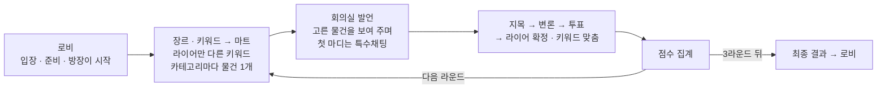
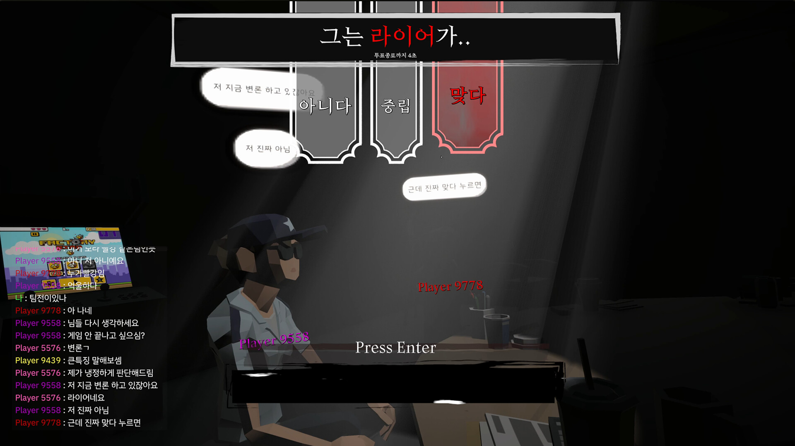
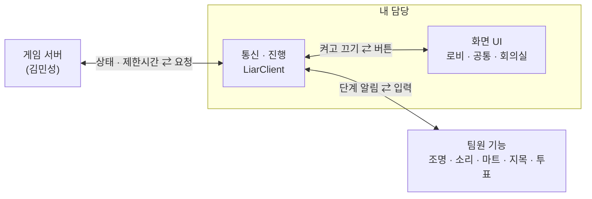
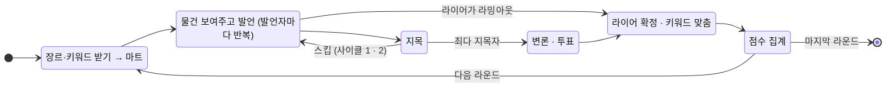
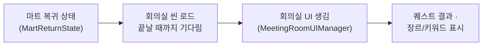

# 시장에 가면

> 마트에서 각자 물건을 골라 와 회의실에서 소개하며, 혼자 다른 키워드를 받은 **라이어**를 찾아내는 **4인 온라인 추리 게임**
>
> Unity 6 · C# · WebSocket · 4인 팀 프로젝트 (클라이언트 담당) · 2026.08.26 \~ 2026.09.10


| 항목 | 내용 |
|---|---|
| 엔진 · 언어 | Unity 6 (6000.3.15f1), URP · C# |
| 주요 패키지 | UniTask(기다리는 동안 게임을 멈추지 않는 비동기 처리), Newtonsoft.Json, DOTween(값을 시간에 따라 서서히 바꾸는 트윈), uGUI + TextMeshPro, Input System |
| 서버 | ASP.NET Core WebSocket 서버 (김민성 님 작성, 별도 저장소). 서버와 클라이언트가 주고받는 메시지의 양식(프로토콜)도 서버가 정함 |
| 협업 도구 | GitHub 조직 저장소, Fork(Git 클라이언트), Asana, JetBrains Rider |
| 기간 | 16일 (그 전 준비 기간 4일) |
| 규모 | 담당 스크립트 7개 약 3,500줄 중 본인 작성 약 2,500줄 (서버 프로토콜에 맞춘 `Protocol.cs`·`CreateNetworkManager.cs` 약 700줄 포함) |

- GitHub: https://github.com/rlawlsdn77/Unity-3D-IfIWasInMarket (내 코드는 `Assets/10. Scripts/06. Server And WebSocket/KJW_LIARGAME/Scripts`)

<!-- ✍️ 시연 영상이 생기면 이 자리에 "- 시연 영상: <주소>" 줄을 추가. '(추가 예정)' 같은 빈 자리표시자는 읽는 사람에게 '링크 없음'과 같아서 뺐습니다 -->

---

## 1. 게임 소개

시장에 가면은 4명이 한 방에 모여 3라운드를 진행하는 온라인 라이어게임입니다. 라운드가 시작되면 모두 같은 장르와 키워드를 받는데, 단 한 명 라이어만 다른 키워드를 받습니다. 플레이어들은 마트에 흩어져 카테고리마다 키워드에 어울리는 물건을 하나씩 고르고, 회의실로 돌아와 차례대로 고른 물건을 보여 주며 발언합니다. 발언자의 첫 마디(특수채팅)는 기록으로 남고, 이를 근거로 라이어를 지목·투표합니다.

라이어는 자기가 라이어인 줄 모르는 채로 시작하고, 발언 중에는 [라밍아웃 버튼](#7-라밍아웃-버튼)(내가 라이어라고 짐작될 때 누르는 버튼)도 있습니다.

| 마트: 카테고리별 물건 고르기 | 마트: 밀치기 | 회의실: 라이어 지목 |
|---|---|---|
|  |  |  |

팀장 백성현 님이 정한 기획 의도는 두 가지였습니다. 기존 라이어게임의 선형적인 흐름(키워드 받기 → 발언 → 지목 → 투표 → 결과)에 마트를 더해, 유리한 아이템을 선점하거나 다른 플레이어를 밀치는 상호작용으로 플레이를 다양하게 하는 것. 그리고 자신이 라이어인지 추측해 누르는 '라밍아웃 버튼'으로 큰 점수 차를 뒤집을 기회를 주는 것입니다.

목표한 경험은 플레이한 사람이 끝나고 **"기존 라이어 게임보다 신선한 게임이다"** 라고 말하는 것이었습니다.

제가 맡은 클라이언트(플레이어마다 실행하는 게임 프로그램)에서 이 목표는, 서버가 다음 상태와 제한시간을 보내면 4명의 클라이언트가 같은 순간에 같은 장면으로 넘어가게 하는 일이었습니다. 4명이 같은 장면을 보며 함께 추리해야 마트에서 고른 물건·특수채팅·라밍아웃이 단서가 되기 때문입니다.

이 흐름을 만들며 부딪힌 문제는 네 가지였고, 이 문서는 그 넷을 다룹니다.

| 핵심 기능 | 부딪힌 문제 | 이렇게 풀었다 |
|---|---|---|
| [턴 메시지 처리](#5-턴-메시지-처리) | 상태(서버가 알려 주는 진행 단계) 하나가 여러 곳을 바꾼다 | 단계마다 할 일을 한곳에 모아 정해진 순서로 처리한다 |
| [UI 구조 다시 짜기](#6-ui-구조-다시-짜기) | UI가 상태 수만큼 늘어난다 | 단계가 바뀌는 순간에만 창을 켜고 끄고, 장면마다 따로 둔다 |
| [라밍아웃 버튼](#7-라밍아웃-버튼) | 누른 사람에게는 결과를 바로, 라이어 공개는 4명 모두에게 같은 순간 보여야 한다 | 라이어가 아닌 사람이 누르면 안내를 클라이언트가 바로 띄우고, 점수 판정과 라이어 공개는 서버가 알린 순간에 한다 |
| [채팅 3종 자동 판별](#8-채팅-3종-자동-판별) | 같은 입력창에서 채팅의 의미가 바뀐다 | 입력창은 하나, 어떤 채팅인지는 지금 단계와 말하는 사람으로 정한다 |

---

## 2. 한 판의 흐름

| 00. LobbyRoom | 02. Mart | 01. MeetingRoom |
|---|---|---|
|  |  |  |
| 방 입장, 대기, 준비·시작, 최종 결과 뒤 복귀 | 물건 고르기, 개인 퀘스트, 밀치기 | 장르·키워드 공개, 발언, 지목, 변론, 투표, 라이어 확정, 점수, 최종 결과 |

한 판은 아래 고리를 3라운드 되풀이합니다.



- 발언은 카테고리마다 한 바퀴(사이클)씩, 한 라운드에 3사이클 돕니다. 사이클 1·2의 지목은 건너뛸 수 있어 다음 카테고리 발언으로 넘어가고, 마지막 사이클은 반드시 지목해야 합니다.
- 발언 중에는 모두에게 [라밍아웃 버튼](#7-라밍아웃-버튼)이 보입니다.
- 점수는 투표 성공, 라이어의 키워드 맞춤, 라밍아웃, 개인 퀘스트 성공 여부를 서버가 합산합니다.


<small>1라운드(약 5분)를 4초마다 한 장씩 10초로 빨리 감은 화면: 로비 → 마트 → 회의실 발언 → 지목 → 변론 → 투표 → 라이어 확정 → 점수 집계</small>

| 상황 | 입력 | 동작 |
|---|---|---|
| 마트 | WASD · F · Space · Q | 이동 · 물건 집기/내려놓기 · 밀치기(물건을 든 동안은 불가) · 고른 물건 목록 |
| 회의실 | TAB (누르는 동안) | 정보창: 이번 라운드 내 물건 목록, 특수채팅 기록 |
| 회의실 | 마우스 왼쪽 클릭 · 버튼 | 지목(같은 사람을 다시 누르면 취소) · Skip · 투표(맞다/모르겠다/아니다) · 라밍아웃 |

**참고한 게임.** Steam의 *Liar Game*에서 한 명만 다른 정보를 가진 채 대화로 서로를 추리하고, 지목·투표로 찾아내는 규칙을 참고했습니다. 이 프로젝트에서 다른 점은, 키워드를 말로만 설명하지 않고 마트에서 고른 물건을 보여 주며 설명한다는 것입니다. 라이어도 시민과 다른 키워드를 받고, 라밍아웃으로 판을 뒤집을 수 있습니다.



---

## 3. 팀 구성과 내 담당

팀원 네 명이 맡은 부분은 아래와 같습니다.

| 팀원 | 맡은 부분 |
|---|---|
| 백성현 | 회의실·마트 맵, UI 디자인(로비·공통·회의실·마트 UI 리소스와 배치), `LightManager`·`SoundManager`, 타이틀·튜토리얼, `main` 병합 |
| 김민성 | 게임 서버(ASP.NET Core WebSocket)와 턴 메시지 프로토콜, 장르·키워드·아이템 데이터 테이블, 마트 매대·아이템 배치, 준비(Ready) 기능 |
| 나정원 | 캐릭터 이동·애니메이션, 아이템 집기·내려놓기·밀치기와 서버 연동, 지목 화살표·투표 시스템, 플레이어 색상 |
| **김진우 (본인)** | 라이어게임 클라이언트: 턴 상태 22종 처리(`LiarClient`), 로비·공통·회의실 UI 매니저와 상태별 공지 패널, 채팅 3종, 턴에 맞는 조명 배치·전환(DOTween)과 BGM·SFX 연결, 서버 프로토콜 변경에 맞춘 클라이언트 리팩터링 |

`LiarClient`는 강의에서 배운 WebSocket 예제 `RoomClient`(접속·수신 루프·전송 잠금)를 바탕으로 라이어게임 메시지 처리를 더한 것입니다. 본문의 핸들러는 서버가 보낸 상태 하나를 받았을 때 할 일을 모아 둔 함수를 말합니다. 협업 과정의 문제는 [11장](#11-협업과-병합)에서 다룹니다.

작업은 준비(08.22\~) → 첫 구현(08.26\~) → Canvas 전환(08.30\~) → 리팩터링(09.02\~) → 연출·마감(09.06 \~ 09.10) 순서였고, 본문에서 '첫 구현', '리팩터링 뒤'처럼 말할 때는 이 단계를 가리킵니다.

---

## 4. 전체 구조

이 게임의 진행은 서버가 정하고, 클라이언트는 서버가 보낸 데이터를 올바르게 해석해 화면을 바꾸는 쪽입니다. 기술 목표는 개발 마감까지 3라운드 한 판이 끝까지 돌고, 서버 프로토콜이 바뀌어도 클라이언트가 따라갈 수 있는 구조를 만드는 것이었습니다.

아래 그림에서 볼 것은 서버와 주고받는 길이 `LiarClient` 하나뿐이라는 점입니다.



> 화살표 위 글은 「`LiarClient`가 보내는 것 ⇄ 받는 것」입니다. 화면 UI와 팀원 기능은 서버를 직접 알지 않습니다.

구조 전체를 관통하는 규칙은 세 가지입니다.

1. 진행은 서버가 정하고, 상태 값은 한 곳에서만 쓴다. → [5.2](#52-상태마다-할-일을-한-함수에)
2. UI는 상태가 바뀌는 순간에만 부른다. → [6장](#6-ui-구조-다시-짜기)
3. 연출은 서버가 확정한 순간에 붙인다. → [9장](#9-조명사운드-연출-연결)

씬 전환은 `LiarClient`의 씬 전환 함수 한 곳에서만 합니다. 새 씬을 Additive(지금 씬을 둔 채 새 씬을 겹쳐 불러오는 방식)로 불러 활성 씬으로 바꾼 뒤 이전 씬을 내립니다(→ [5.4](#54-씬이-바뀔-때-회의실-ui가-뜨지-않던-문제)).

---

## 5. 턴 메시지 처리

기존 라이어 게임에 없는 마트 단계를 더해, 서버가 보내는 턴 상태에 맞춰 마트와 회의실을 오가는 흐름을 만듭니다.


### 5.1 턴 상태 22종

서버는 상태가 바뀔 때마다 "지금은 이 상태, 제한시간은 N ms"를 4명 모두에게 보내고, 클라이언트는 받은 순간 그 상태에 맞는 화면으로 넘어가야 합니다. 상태는 22종이고, 하나를 받으면 할 일이 여러 가지입니다.

| 받은 상태 (예) | 클라이언트가 할 일 |
|---|---|
| `MartReturnState` (마트에서 복귀) | 손에 든 물건 정리 → 유저별 고른 물건·퀘스트 결과 저장 → 회의실 씬 로드 → 채팅·TAB 정보창·퀘스트 결과·장르/키워드 UI → 퀘스트 SFX → 회의 BGM |
| `PointAtSuspectState` (지목) | 투표 시스템을 지목 단계로 → 스킵 버튼(마지막 사이클 제외) → 테이블 조명 → 지목 안내 → 지목·투표 BGM |

한 라운드 안에서 턴 상태는 서버가 보낸 차례대로 아래처럼 넘어갑니다. 그림에서 볼 것은 발언과 지목 사이를 사이클마다 오가다가, 투표나 라밍아웃 어느 쪽으로든 라이어 확정에 닿는다는 점입니다.



### 5.2 상태마다 할 일을 한 함수에

지목 상태 핸들러는 이 순서로 부릅니다. **① 공통 값 기록(`DoSetPhase`) → ② 팀원 시스템 → ③ 조명 → ④ UI → ⑤ 사운드.** 씬을 옮기거나 화면을 정리하는 핸들러는 이 순서가 조금씩 다릅니다. 줄 끝 주석은 이 순서를 보이려고 문서에서 단 설명입니다.

```csharp
// LiarClient.cs — 지목 상태. 이 상태가 할 일을 정해진 순서로 부른다
private void OnPointAtSuspectState(float timerMs, int cycle, int round)
{
    DoSetPhase(TurnMessageType.PointAtSuspectState, timerMs, cycle, round);      // ① 공통 값 기록

    Vote_System.Instance?.SetTurnType(Vote_System.TurnType.Point, timerMs);      // ② 팀원 시스템: 지목 입력 켜기
    if (cycle != 3) ConferenceManager.Instance?.RequestSkipPointUI(true);         //    스킵 버튼 (마지막 사이클 제외, 하드코딩)

    LightManager.Instance?.TurnOnFocusTable();                                     // ③ 조명: 테이블 전체
    MeetingRoomUIManager.Instance?.ShowPointAtNotice();                            // ④ UI: "라이어로 의심되는 사람을 지목하십시오"

    SoundManager.Instance?.StopBGM();                                              // ⑤ 사운드: 지목·투표 BGM
    SoundManager.Instance?.PlayBGM(SoundManager.GameBGM.LiarGameVoteOrPoint);
}
```

- 모든 핸들러가 상태 기록을 거치므로, "지금 무슨 상태인가"를 바꾸는 길이 하나뿐입니다. 채팅 종류 판별과 라밍아웃 버튼 조건이 모두 이 값을 읽습니다.
- 서버는 제한시간을 상태가 시작될 때 한 번만 보냅니다. 클라이언트는 받은 시각을 기억해 남은 시간을 직접 계산하므로, 매초 시간을 주고받지 않습니다.
- 전체 코드: [LiarClient.cs](https://github.com/rlawlsdn77/Unity-3D-IfIWasInMarket/blob/main/Assets/10.%20Scripts/06.%20Server%20And%20WebSocket/KJW_LIARGAME/Scripts/LiarClient.cs)

### 5.3 턴 메시지를 어떻게 나눠 받을까

리팩터링 단계에서 서버를 맡은 김민성 님이 턴 메시지를 보내는 기능을 넓히기에 지금 구조가 어렵다며 대대적인 리팩터링을 제안했고, 저는 턴 상태를 `TurnMessage` 하나로 통합하는 방향을 골랐습니다. 서버가 이 구조로 바뀐 뒤 클라이언트를 맞춰 다시 짰습니다.

늘어나는 턴 메시지를 어떻게 나눠 받을지 두 방법을 견줬습니다.

| | A. 테이블 기반 매칭 (규칙·조건 표) | B. 턴 상태를 `TurnMessage` 하나로 통합하고, 상태 종류(`TurnMessageType` enum)로 나눈다 ✓ |
|---|---|---|
| 장점 | 값의 조합으로도 핸들러를 고를 수 있다 | 서버 코드와 한 줄씩 맞춰 볼 수 있다 |
| 단점 | 어느 메시지가 어느 핸들러로 가는지 조건 함수를 하나하나 읽어야 안다 | 서버와 클라이언트의 `TurnMessageType` 이름·순서가 어긋나면 엉뚱한 상태로 읽힌다 |

**턴 메시지를 `TurnMessage` 하나로 묶는 쪽(B)을 골랐습니다.** 턴 메시지가 앞으로 더 늘어날 수 있다고 봤고, 그럴수록 서버 코드와 한 줄씩 맞춰 볼 수 있는 쪽이 낫다고 판단했기 때문입니다.

- 리팩터링 뒤 상태마다 있던 메시지 클래스 22개가 `TurnMessage` 하나로, 받는 함수의 한글 문자열 분기 34개가 메시지 종류 14개로 줄었습니다(턴 상태 22종은 그중 하나인 `TurnMessage` 안에서 다시 나눕니다).
- 새 상태를 추가하는 비용이 'enum 값 1 + case 1 + 핸들러 1'로 정해졌습니다.
- 서버가 모르는 메시지 종류를 보내면 로그만 남기고 넘어가, 서버에 맞춰 클라이언트를 고치기 전의 빌드 테스트에서도 코어 루프가 도는지 확인할 수 있게 했습니다. 다만 턴 상태(`TurnMessageType`)를 모르면 예외가 납니다.
- JSON 라이브러리는 사용자 ID 표기가 `ID`·`Id`·`UserID`처럼 섞여 있어, 대소문자만 달라도 값이 조용히 빠지는 System.Text.Json 대신 Newtonsoft.Json을 골랐습니다.

- 전체 코드: [ParseNetworkManager.cs](https://github.com/rlawlsdn77/Unity-3D-IfIWasInMarket/blob/main/Assets/10.%20Scripts/06.%20Server%20And%20WebSocket/KJW_LIARGAME/Scripts/ParseNetworkManager.cs) · [Protocol.cs](https://github.com/rlawlsdn77/Unity-3D-IfIWasInMarket/blob/main/Assets/10.%20Scripts/06.%20Server%20And%20WebSocket/KJW_LIARGAME/Scripts/Protocol.cs)

### 5.4 씬이 바뀔 때 회의실 UI가 뜨지 않던 문제

`LiarClient`는 `DontDestroyOnLoad`(씬이 바뀌어도 파괴하지 않는 Unity 기능)로 씬 밖에 두고, 살아남는 객체를 `LiarClient`·`CommonUIManager`·`SoundManager`로 한정해 나머지는 씬과 함께 버립니다. 씬 전환 함수(`DoLoadScene`)의 구조는 본인(첫 구현), 기다릴 수 있게 바꾼 것은 나정원 님(리팩터링) 작업입니다.

| 항목 | 내용 |
|---|---|
| 문제 | 마트에서 회의실로 돌아오면 바로 떠야 할 퀘스트 결과와 장르·키워드가 뜨지 않았습니다 |
| 원인 | 씬은 몇 프레임에 걸쳐 불러오는데(비동기), 결과를 띄우는 코드가 기다리지 않고 바로 실행됐습니다. 그때는 아직 `MeetingRoomUIManager`가 없었고, 대상이 없으면 건너뛰는 `?.` 때문에 오류도 나지 않았습니다 |
| 해결 | 씬을 다 불러온 뒤에 화면을 띄우게 바꿨습니다(나정원 님, 리팩터링 때). 씬을 옮기는 상태 4종(게임 시작·마트 진입·마트 복귀·최종 결과 종료)이 모두 이 모양입니다 |
| 결과 | 고친 뒤 테스트에서, 마트에서 돌아오자마자 퀘스트 결과와 장르·키워드가 회의실에 뜨는 것을 확인했습니다 |
| 남은 것 | 씬을 불러오는 도중 다음 상태 메시지가 먼저 오면, 그 화면은 여전히 안 뜰 수 있습니다(→ [12장](#124-남은-문제)) |



---

## 6. UI 구조 다시 짜기

상태가 바뀌는 순간 공지 패널이 떠서, 새 규칙(마트·특수채팅·라밍아웃)이 낯선 사람도 지금 무엇을 할지 압니다.

| 장르·키워드 공개 (`CommonUIManager`) | 발언자 공지 (`MeetingRoomUIManager`) | 라밍아웃 버튼 (`MeetingRoomUIManager`) |
|---|---|---|
|  |  |  |

### 6.1 씬마다 UI 나누기

Canvas 전환 단계에서는 Canvas 프리팹 하나(`LiarUICanvasBinder`)에 모든 UI를 두어, 로비용 방 정보·채팅이 마트·회의실에서도 계속 보였습니다. 리팩터링 단계에서 타이머·채팅처럼 장면을 넘어 이어져야 하는 것만 공통 UI(`CommonUIManager`)로 두고 나머지는 쓰는 씬의 UI 매니저(로비·회의실)에 넣었습니다.

- 전체 코드: [CommonUIManager.cs](https://github.com/rlawlsdn77/Unity-3D-IfIWasInMarket/blob/main/Assets/10.%20Scripts/06.%20Server%20And%20WebSocket/KJW_LIARGAME/Scripts/CommonUIManager.cs) · [LobbyUIManager.cs](https://github.com/rlawlsdn77/Unity-3D-IfIWasInMarket/blob/main/Assets/10.%20Scripts/06.%20Server%20And%20WebSocket/KJW_LIARGAME/Scripts/LobbyUIManager.cs) · [MeetingRoomUIManager.cs](https://github.com/rlawlsdn77/Unity-3D-IfIWasInMarket/blob/main/Assets/10.%20Scripts/06.%20Server%20And%20WebSocket/KJW_LIARGAME/Scripts/MeetingRoomUIManager.cs)

### 6.2 UI를 언제 갱신할까

UI를 언제 갱신할지 두 방법을 견줬습니다.

| | A. 매 프레임 상태를 보고 판단한다 (폴링, 리팩터링 전) | B. 상태에 들어오는 순간 UI 함수를 부른다 (리팩터링 뒤) |
|---|---|---|
| 장점 | 호출을 빠뜨릴 일이 없다 | "이 상태에 무엇이 뜨는가"가 상태 핸들러 한 곳에 모인다 |
| 단점 | 어떤 상태에 무엇이 뜨는지 알려면 갱신 함수 12개를 모두 읽어야 한다 | 호출을 빠뜨리면 패널이 안 뜨거나 남는다(실제로 2라운드부터 타이머가 안 켜졌다) |

둘을 나눠 썼습니다. 패널을 켜고 끄는 일은 상태가 바뀌는 순간에만 일어나므로 대안 B로, 타이머처럼 한 상태 안에서도 계속 바뀌는 값은 대안 A로 남겼습니다. 대가인 '빠뜨림'은 두 규칙으로 줄였습니다. 한 번에 하나만 보이는 공지는 모두 '모든 공지 끄기'(`HideAllPanels()`)로 시작해 이전 공지를 끄는 것을 잊을 수 없게 했고, 타이머처럼 매 라운드 다시 켜야 하는 UI는 라운드가 시작되는 상태(장르 배분)에서도 켜도록 했습니다.

### 6.3 TAB 정보창이 켜진 채 남던 문제

| 항목 | 내용 |
|---|---|
| 문제 | TAB을 떼도 정보창이 꺼지지 않고, 다시 누를 때까지 켜진 채 남았습니다 |
| 원인 | TAB을 누를 때마다 켜짐·꺼짐을 뒤집는 방식(토글)이었습니다. 그래서 한 번 누르면 다시 누를 때까지 켜진 채 남았고, 채팅 중에는 TAB 입력을 무시해 끌 수도 없었습니다 |
| 해결 | 켜짐·꺼짐을 기억해 두지 않고, 매 프레임 'TAB이 눌려 있고 채팅 중이 아닌가'로 정합니다 |
| 결과 | TAB을 누르는 동안만 정보창이 보이고, 떼면 바로 꺼지는 것을 플레이로 확인했습니다 |


<small>TAB을 누르는 동안 회의실 가운데에 뜨는 정보창: 이번 라운드 내 아이템(카테고리별 물건)과 특수 채팅 기록이 `닉네임(소개한 물건) : 내용`으로 쌓여 있다</small>

- 전체 코드: [CommonUIManager.cs](https://github.com/rlawlsdn77/Unity-3D-IfIWasInMarket/blob/main/Assets/10.%20Scripts/06.%20Server%20And%20WebSocket/KJW_LIARGAME/Scripts/CommonUIManager.cs) (TAB 정보창)

---

## 7. 라밍아웃 버튼

라밍아웃은 발언 중에 '내가 라이어 같다'고 추측한 사람이 누르는 버튼입니다. 기획 의도대로, 라이어가 스스로를 맞히면 큰 점수 차를 뒤집을 기회가 됩니다.


<small>발언 중 라이어가 라밍아웃 버튼을 누른 순간: 라이어에게 붉은 조명, 아래에 라밍아웃 공지, 이어서 키워드 맞춤 결과와 점수</small>

| 누른 사람 | 누른 사람의 화면 | 4명 모두의 화면 | 점수 |
|---|---|---|---|
| 라이어 | — | 서버가 알린 순간 라이어에게 붉은 조명, "라이어 ○○ 님이 라밍아웃 버튼을 눌렀습니다" 공지, 효과음 → 바로 키워드 맞춤 단계 | 서버가 합산 |
| 라이어가 아닌 사람 | 누른 즉시 "당신은 라이어가 아닙니다" (본인에게만) | 바뀌지 않음, 턴은 그대로 이어짐 | 깎인 점수는 점수 집계 때 적용 |

버튼은 「발언 상태 + 남은 시간 3초 초과 + 이번 라운드에 아직 안 누름」일 때만 보입니다. 남은 시간이 3초가 되는 순간에는 서버 메시지가 오지 않기 때문에, 회의실 UI가 매 프레임 판단합니다.

이 버튼에서 정한 것은 세 가지입니다.

- **판정은 나눠서.** 누른 사람에게 결과를 바로 알리면서, 점수는 서버 한 곳에서만 정해지게 하려는 것이었습니다. 대가로 모든 클라이언트가 라운드 시작부터 라이어 정보를 받게 되어, 이것은 [12장](#124-남은-문제)의 과제로 남겼습니다.
- **한 라운드에 한 번.** 라이어인지 추측해 리스크를 안고 누르는 **한 번의 결정**이 되게 하려는 것이었습니다.
- **공개는 서버가 알린 순간에.** 4명이 같은 순간에 같은 장면을 보고, 점수 차를 뒤집는 순간이 눈에 띄게 하려는 것이었습니다.

버튼을 누르면 라이어가 아닌 사람에게는 바로 안내를 띄우고, 서버에는 요청만 보냅니다.

```csharp
// LiarClient.cs — 라밍아웃 버튼을 눌렀다. 실제 라이어인지는 서버가 검증한다.
public void RequestLiarSelfDisclose()
{
    if (Me == null) return;

    LiarButtonClicked = true;
    if (LiarId != Me.Id)
    {
        IsNotLiarPushCycle = true;
        MeetingRoomUIManager.Instance?.ShowNotLiarNotice(); // 라이어가 아닌 사람이 라밍아웃 버튼을 누름
    }

    SendAsync(new LiarSelfDisclose { ID = Me.Id }).Forget();
}
```

플레이 테스트에서 받은 반응은 [12장](#121-목표한-경험은-전해졌나)에 있습니다.

- 전체 코드: [MeetingRoomUIManager.cs](https://github.com/rlawlsdn77/Unity-3D-IfIWasInMarket/blob/main/Assets/10.%20Scripts/06.%20Server%20And%20WebSocket/KJW_LIARGAME/Scripts/MeetingRoomUIManager.cs) (버튼) · [LiarClient.cs](https://github.com/rlawlsdn77/Unity-3D-IfIWasInMarket/blob/main/Assets/10.%20Scripts/06.%20Server%20And%20WebSocket/KJW_LIARGAME/Scripts/LiarClient.cs) (`RequestLiarSelfDisclose`, `OnLiarOutButtonPressedState`)

---

## 8. 채팅 3종 자동 판별

일반·특수(발언자의 첫 마디)·키워드(라이어의 첫 마디)처럼 상황에 맞게 채팅 종류를 나누고 그 기록을 남겨, 다른 플레이어가 무슨 말을 했는지 다시 볼 수 있게 했습니다.

| 종류 | 언제 · 누가 | 보이는 곳 | 기록 |
|---|---|---|---|
| 일반 | 아무 때나 · 누구나 | 채팅창 (최근 12줄) | — |
| 특수 | 발언 상태 · 발언자의 첫 마디 | 채팅창 `[특수]` · 발언 종료 공지(전체) · TAB 정보창 | 라운드 동안 누적, `닉네임(소개한 물건) : 내용` |
| 키워드 | 라이어의 키워드 맞춤 상태 · 라이어의 첫 마디 | 채팅창 `[키워드]` · 키워드 맞춤 종료 공지(제출한 키워드 / 라이어 키워드 / 시민 키워드) | 그 상태 동안 |

![투표 상태의 회의실. 왼쪽 아래 채팅창에 [키워드]·[특수]·일반 채팅이 보낸 사람의 색으로 섞여 있고, 내가 보낸 줄에는 (나)가 붙는다. 가운데 투표 창은 팀원 작업](images/08_chat_vote.png)

<small>투표 상태의 회의실. 왼쪽 아래 채팅창에 [키워드]·[특수]·일반 채팅이 보낸 사람의 색으로 섞여 있고, 내가 보낸 줄에는 (나)가 붙는다. 가운데 투표 창은 팀원 작업</small>

| 특수채팅: 발언 공개 | 키워드채팅: 맞춤 결과 |
|---|---|
| ![발언자의 첫 마디가 특수채팅이 되어 가운데 '발언 공개' 창에 뜨고, 왼쪽 채팅창에는 [특수]로 남는다](images/chat_special.png) | ![라이어의 키워드 맞춤이 끝난 뒤 뜨는 공지: 라이어가 제출한 키워드 · 라이어의 키워드 · 플레이어의 키워드. 오른쪽은 점수 집계, 채팅창 맨 아래에 [키워드] 줄](images/keyword_guess_result.png) |

입력창은 하나이고, 보내기 버튼과 Enter가 모두 `Say(text)` 하나만 부릅니다. 입력창 하나에서 '발언자의 첫 마디 = 특수채팅', '라이어의 첫 마디 = 키워드채팅'이 되는 것은 팀 기획 규칙이고, 제가 정한 것은 이 규칙을 **어디에서 판단할지**였습니다. 두 곳을 견줬습니다.

| | A. 입력 UI가 판단한다 (`CommonUIManager`가 상태를 보고 보낼 함수를 고른다) | B. `LiarClient.Say` 한 곳에서 판단한다 (UI는 글만 넘긴다) ✓ |
|---|---|---|
| 장점 | 입력을 받는 곳에서 바로 정해 흐름이 짧다 | 판단에 필요한 값(상태·발언자·라이어 ID)이 모두 서버 메시지로 `LiarClient`에 기록되어 있다. 보내는 입력이 몇 개든 규칙은 한 곳에만 있다 |
| 단점 | UI가 현재 상태·발언자·라이어 ID를 모두 알아야 한다. 채팅을 보내는 입력이 늘면(보내기 버튼, Enter) 같은 판단을 곳곳에 복사하게 된다 | 판단이 클라이언트에만 있다. 서버가 같은 규칙으로 다시 확인하지 않으면, 조작된 클라이언트가 특수채팅을 여러 번 보낼 수 있다 |

**`Say` 한 곳에서 판단하는 쪽(B)을 골랐습니다.** 기획 규칙이 바뀌어도 `Say`만 고치면 됩니다. 대가인 서버 쪽 검증은 과제로 남았습니다(→ [12장](#124-남은-문제)). 보내는 순간 플래그를 세우므로, 서버 응답을 기다리는 사이 Enter를 연달아 눌러도 두 번째부터는 일반채팅이 됩니다.

`Say`는 지금 상태와 말하는 사람을 보고 채팅 종류를 고릅니다.

```csharp
// LiarClient.cs — 지금이 어떤 채팅을 보낼 차례인지 알아서 판단해서 보낸다.
public void Say(string text)
{
    if (string.IsNullOrWhiteSpace(text)) return;
    if (Me == null) return;

    // 발언 상태 + 내가 발언자 + 이번 차례에 아직 특수채팅을 안 보냈으면, 첫 마디는 특수채팅이 된다.
    if (CurrentState == TurnMessageType.ShowItemAndSpeakState && CurrentOwnerID == Me.Id &&
        hasSentSpecialChat == false)
    {
        hasSentSpecialChat = true;
        RequestSpecialChat(text);
        return;
    }

    // 라이어의 키워드 맞춤 상태 + 내 id가 라이어 id와 동일하면 + 아직 키워드채팅을 안 보냈으면, 첫 마디는 키워드채팅이 된다.
    if (CurrentState == TurnMessageType.LiarKeywordGuessState && LiarId == Me.Id && hasSentKeywordChat == false)
    {
        hasSentKeywordChat = true;
        RequestKeywordChat(text);
        return;
    }

    RequestNormalChat(text);
}
```

특수채팅 기록은 처음에 사이클마다 비웠는데, 플레이 테스트에서 팀원들에게 앞 사이클의 발언이 사라져 비교가 안 된다는 피드백을 받아 다음 날 라운드 단위로 바꿨습니다. 길어진 기록(최대 12줄)도 한눈에 보이도록 한 줄에 그 사람이 소개한 물건을 함께 넣었습니다(`닉네임(소개한 물건) : 내용`).

- 전체 코드: [LiarClient.cs](https://github.com/rlawlsdn77/Unity-3D-IfIWasInMarket/blob/main/Assets/10.%20Scripts/06.%20Server%20And%20WebSocket/KJW_LIARGAME/Scripts/LiarClient.cs) (`Say`)

---

## 9. 조명·사운드 연출 연결

회의실에서는 4명이 한 테이블에 둘러앉아 있어, 화면만 봐서는 지금 누가 말하는지, 누가 지목됐는지 알기 어렵습니다. 상태마다 '주인공'(발언자 → 최다 지목자 → 라이어)과 분위기가 바뀝니다. 조명·사운드 매니저(백성현 님)는 '어떻게 켜는지'를 갖고 있었고(테이블·라이어 조명과 서서히 밝아지는 전환은 제가 더함), 저는 **언제, 누구에게, 무엇을** 켤지를 턴 흐름에 맞춰 연결했습니다.

| 받은 상태 · 메시지 | 조명 | BGM | SFX |
|---|---|---|---|
| 물건 보여주고 발언 | 발언자 (흰색, 반경 10) | | |
| 지목 | 테이블 전체 (반경 30) | 지목·투표 | |
| 지목 종료 | 최다 지목자 · 스킵이면 테이블 | | |
| 라이어 확정 | 라이어 (붉은색, 밝기 +500) | | 라이어 공개 · 다른 사람이 지목됐으면 추정 실패 |
| 라밍아웃 버튼 누름 | 라이어 (붉은색) | | 라밍아웃 |
| 점수 집계 | 테이블 | | 점수 공개 |
| 최종 결과 | 테이블 중앙 | 승리 / 패배 (내 결과에 따라) | |

| 발언자 | 지목 (스킵 버튼) | 라이어 (라밍아웃) |
|---|---|---|
|  |  |  |

- 조명은 바뀔 때마다 밝기 0에서 5초 동안 서서히 밝아집니다. 턴마다 조명이 바뀌는 게임이라, 갑자기 켜지는 조명의 피로감을 낮추려는 것입니다.
- 지목이 스킵되면 서버가 빈 ID를 보내, 4명의 화면에서 저마다 자기 캐릭터에 조명이 켜지던 문제를 고쳤습니다. 스킵이면 테이블을 비춥니다.
- 지목 단계 내내 효과음이 매 프레임 겹쳐 깨지던 문제를 고쳤습니다. 효과음은 서버가 지목을 알린 순간(지목 메시지를 받을 때)에 한 번, 4명 모두에게 같은 순간 울립니다.
- 최종 결과는 우승자가 아니라 테이블 중앙을 비춰, 4명의 승패 애니메이션이 동시에 갈리는 장면이 보이게 했습니다.

| 서서히 밝아지는 발언자 조명 | 최종 결과: 테이블 중앙 |
|---|---|
|  |  |

---

## 10. 나머지 기능

| 기능 | 요점 |
|---|---|
| 로컬 플레이어 동적 생성 | 내 ID·닉네임을 서버의 welcome으로 받을 때 플레이어를 프리팹으로 만들어, 바로 내 정보로 채운다 |
| 투표 로그 | 투표 대상자의 화면에만 다른 사람의 투표가 쌓인다. 다른 투표자가 앞사람의 투표에 휩쓸리지 않고 자기 추리대로 투표하게 했다 |
| 최종 결과 → 로비 | 결과를 보여 준 뒤 로비로 돌아가고, 점수·게임 시작 여부를 초기화해 같은 방에서 다시 시작할 수 있다 |
| 채팅창 스크롤 | 새 줄이 오면 맨 아래로 내려 최신 채팅이 바로 보이게 한다 |

---

## 11. 협업과 병합

### 11.1 개인 브랜치끼리 합쳐 이력이 꼬인 문제

| 항목 | 내용 |
|---|---|
| 문제 | 나정원 님이 투표·연출 구조를 바꾼 뒤 제 개인 브랜치(`kim-jw-work`)를 자기 브랜치에 병합했고, 저는 이를 되돌렸다가 다시 반영했다가 또 되돌렸습니다. 되돌리기가 겹쳐 어느 시점의 파일이 맞는지 알 수 없게 됐습니다 |
| 원인 | ① 서로의 개인 브랜치를 직접 합쳐 상대의 작업 중인 변경까지 들어왔고, ② Unity 씬·프리팹(YAML)은 충돌한 줄을 손으로 맞추기 어려우며, ③ 저장소에 올라간 개인 IDE 설정 파일이 병합 때마다 충돌할 수 있었습니다 |
| 해결 | 꼬인 병합 구간을 이력에서 걷어 내 문제 전 시점으로 되돌렸고, 나정원 님이 정리된 브랜치를 그날 다시 병합해 복구를 마쳤습니다 |
| 이후 | 다음 날부터 팀은 작업 하나마다 브랜치를 따서 `main`에 합쳤습니다. 되돌릴 병합은 다시 없었지만, 충돌은 계속 났습니다(11.2) |

### 11.2 한 파일에 몰린 병합 충돌

`LiarClient.cs`는 서버 메시지가 모두 지나가는 곳이라, 팀원도 자기 기능의 수신 처리를 이 파일에 넣었습니다. 브랜치 방식을 바꾼 뒤에도 병합 세 번에 한 번꼴로 충돌이 났고, 그 절반 이상이 `LiarClient.cs`였습니다. 파일의 책임을 나누는 것을 [12장 과제 표](#124-남은-문제)의 첫 과제로 남겼습니다.

### 11.3 프로토콜 정의를 둘 곳

서버와 클라이언트가 각자 `Protocol.cs`를 갖고, 서버가 바뀌면 클라이언트 쪽을 손으로 맞추는 방식이었습니다(주로 제가 맡음). 필드 이름이 곧 계약이라, 향후에는 프로토콜 정의를 서버·클라이언트가 함께 참조하는 공용 프로젝트(또는 패키지) 하나로 두는 것이 맞다고 봅니다.

---

## AI와 함께 만든 방식

| | 내용 |
|---|---|
| 맡긴 것 | 턴 메시지 수신 리팩터링 가운데 2차 분기를 맡는 `ParseNetworkManager.cs` 작성. 서버가 보내는 턴 메시지 양식과 `Protocol.cs`가 대대적으로 바뀌었기 때문입니다(5.3). `LiarClient`의 받는 쪽 분기 정리·핸들러 인자 변경·구독 연결은 직접 했습니다 |
| 직접 판단한 것 | ① UI 매니저 하나에 모든 씬의 UI가 몰려 한 클래스가 너무 많은 것에 얽힌 코드가 되었고, 유지보수를 위해 씬별 UI로 나눴습니다(6장). ② 서버 담당 팀원의 리팩터링 제안을 받아, 턴 메시지를 TurnMessage 하나로 통합하는 방향은 제가 골랐고(5.3), 받는 쪽 변경도 직접 했습니다 |
| 확인 방법 | 코드를 읽고 이해함 · 실행·팀 플레이 테스트 |

<!-- ✍️ 확인: 위 '맡긴 것'은 ParseNetworkManager.cs 작성뿐인데, 아래 '안 된 점'의 예시는 AI가 LiarClient.cs의 #region On에 함수를 쓴 일입니다. AI가 LiarClient.cs에도 코드를 썼다면 '맡긴 것' 칸에 그 범위를 더하세요 -->

잘 된 점은 상태 22개의 Action 필드와 case를 손으로 쓰지 않고 한 번에 받은 것입니다.

안 된 점도 있었습니다. 통신 규약(`Protocol.cs`)은 서버 담당 팀원과 맞춰야 하는데, AI가 이 규약까지 임의로 바꿔 규약에 맞지 않는 코드를 쓰는 일이 종종 있었습니다. 예를 들어 `LiarClient.cs`의 `#region On`에 `Protocol.cs` 양식에 맞지 않는 턴 메시지 함수가 작성된 적이 있습니다. 서버의 디버그 로그에서 오류를 발견해, 바로 이전 턴 메시지와 해당 메시지에 디버그 로그를 추가해 찾은 뒤 고쳤습니다.

---

## 12. 돌아보며

### 12.1 목표한 경험은 전해졌나

목표는 플레이한 사람이 "기존 라이어 게임보다 신선한 게임이다"라고 말하는 것이었습니다(1장). 플레이 테스트에서 받은 반응 가운데 이 목표에 닿은 것은 두 가지였습니다.

- 마트에서 자신이 받은 장르와 키워드에 맞는 아이템을 집으려고 뛰어다니고, 다른 사람을 밀치는 상호작용이 신선하다는 피드백
- 라밍아웃으로 자신이 라이어인지 아닌지 추측해 리스크를 안고 점수를 노릴 수 있어, 점수를 역전할 기회가 되었다는 피드백

다만 라밍아웃은 라이어가 아닌 사람이 누르면 점수가 깎이기 때문에, 서로 잘 누르지 않는 판도 있었습니다.

팀 플레이 테스트에서 4명이 같은 장면을 보며 함께 추리한다는 느낌이 실제로 든 순간은, 마트에서 회의실로 돌아와 모두 자리에 앉고 어두운 회의실에서 테이블에 조명이 비췄을 때였습니다. 이 테이블 조명과 턴에 맞는 조명 배치는 제가 맡은 부분입니다([9장](#9-조명사운드-연출-연결)). 받은 피드백 중 "사운드가 깨지는 버그"는 [9장](#9-조명사운드-연출-연결)의 지목 효과음 문제로, 고쳤습니다.

### 12.2 기술 목표는 이뤘나

팀 전체로는 로비 → 마트 → 회의실이라는 핵심 루프를 설계·구현하고, 턴마다 맞는 UI/UX를 제공했습니다. 그 안에서 제가 이룬 것은 두 가지입니다. 서버에서 받은 턴 메시지의 데이터를 각 객체에 전달해 턴이 올바르게 진행되도록 구현했고, UI 담당 팀원이 만든 UI가 알맞은 턴에 보이도록 연결했습니다.

| 목표 | 결과 |
|---|---|
| 3라운드 한 판이 끝까지 돈다 (4장) | 로비 → 3라운드 → 최종 결과 → 로비 복귀까지 동작 |
| 서버 프로토콜이 바뀌어도 따라간다 (4장) | 새 상태 추가 = enum 1 + case 1 + 핸들러 1 ([5.3](#53-턴-메시지를-어떻게-나눠-받을까)) |
| UI가 상태 수만큼 늘어도 관리된다 (1장) | UI 매니저 3개(공통·로비·회의실), 상태 핸들러에서 호출 ([6장](#6-ui-구조-다시-짜기)) |
| 누가 주인공인지 보인다 (9장) | BGM 7종 전부와 SFX 8종을 턴 상태·서버 메시지 핸들러에 연결. 조명 3가지(발언자·테이블·라이어)를 상태 7곳에 연결 |

자동 테스트는 없고, 실행과 팀 플레이 테스트로 확인했습니다.

### 12.3 화면은 상태가 바뀌는 순간과 확정된 사실에 붙인다

- 언제 그릴지는 '상태가 바뀌는 순간'이 정한다. 패널을 켜고 끄는 일은 상태 핸들러로, 상태 안에서도 계속 바뀌는 값(타이머, 남은 3초)만 매 프레임 읽도록 나누자 "이 상태에 무엇이 뜨는가"가 한 곳에 모였습니다.
- 피드백은 확정된 사실에 붙인다. 효과음과 조명을 서버가 확정한 순간으로 옮기자, 4명이 같은 장면을 보게 됐고 '매 프레임 겹쳐 깨지는 효과음' 같은 실수도 구조적으로 사라졌습니다.

### 12.4 남은 문제

| 아쉬운 점 (기술 부채) | 왜 문제인가 | 향후 계획 (To-Be) |
|---|---|---|
| `LiarClient` 한 클래스(1,674줄)에 송수신·상태 22종·씬 전환·UI 호출·연출 호출·마트 응답이 모여 있다 | 상태 하나를 고쳐도 이 파일을 열어야 하고, 병합 충돌의 절반 이상이 이 파일에서 났다(11.2) | 송수신(소켓)·상태 기록·상태별 처리를 나눈다. UI·연출은 '상태가 바뀌었다' 이벤트를 각자 구독한다 |
| 라이어가 누구인지 라운드 시작부터 모든 클라이언트가 받고, 로그에도 찍힌다 | 화면에는 안내되지 않지만 로그나 메모리를 보면 알 수 있다. '당신은 라이어가 아닙니다'도 클라이언트가 이 값으로 판단한다(7장) | 서버(김민성 님)와 함께 프로토콜을 바꿔, 라이어 정보는 라이어 확정·라밍아웃 상태에서만 보낸다. 라밍아웃 결과는 서버가 누른 사람에게 답한다 |
| 채팅 종류 판단이 클라이언트에만 있다 | 서버가 같은 규칙을 다시 확인하지 않으면 특수채팅을 여러 번 보낼 수 있다 | 서버가 상태·발언자·첫 마디 규칙으로 검증한다 |
| 씬 로드 중 도착한 다음 상태의 UI 호출은 `?.`로 조용히 건너뛰어진다 | 지금은 상태 사이 간격 덕분에 드러나지 않을 뿐 순서 보장이 없다 | 받은 상태를 큐에 넣고, 씬 전환이 끝난 뒤 순서대로 적용한다 |
| UI에 코루틴이나 tween으로 연출을 넣으려 했지만, 개발 마감 때문에 포기했다 | 지금 UI는 켜고 끄기만 해서 퀄리티가 떨어진다 | — |
