# OverFixed!

> 우주 화물선의 정비원이 되어 선외로 흘러가는 재료를 모아 주문을 채우고, 사고를 수습하며 항해를 버티는 1인칭 3D 아케이드
>
> Unity 6 · C# · 1인 개인 프로젝트 · 2026.10.21 \~ 2026.11.04


| 항목 | 내용 |
|---|---|
| 엔진 · 언어 | Unity 6 (6000.3.15f1), URP · C# |
| 주요 패키지 | Input System(입력 처리), uGUI + TextMeshPro(화면 UI·글자), DOTween(값을 시간에 따라 서서히 바꾸는 트윈) |
| 외부 에셋 | 함선 내부·소품, 플레이어 로봇(Robobot T7), 우주 스카이박스 |
| 도구 | JetBrains Rider, Git / GitHub |
| 인원 | 1인 |
| 규모 | C# 스크립트 53개(약 3,400줄), 씬 3개, 밸런스 표(TSV) 4종, 설정 ScriptableObject(Unity에서 값을 담아 두는 파일) 7종 |

- GitHub: https://github.com/rlawlsdn77/Unity-3D-OverFixed (게임 코드는 `Assets/OverFixed!/Scripts`, 그 밖의 폴더는 수업 실습)
- 시연 영상: https://www.youtube.com/watch?v=hp_KYSpKFlc
- 스크립트 수와 줄 수는 `Assets/OverFixed!/Scripts` 기준이고, 배운 코드는 빼고 AI와 함께 쓴 부분은 넣었습니다.

---

## 1. 게임 소개

OverFixed!는 화물선이 목적지에 도착하기까지 한 번의 항해(4\~6분)를 버티는 1인칭 3D 아케이드입니다.

플레이어는 에어락을 지나 선외로 나가 우주를 흘러가는 재료를 잡고, 선내 터미널에 제출해 주문을 채웁니다. 주문 보상으로 받은 크레딧은 도착 전까지 내야 하는 할당량과, 매초 줄어드는 코어 안정도를 회복하는 데 나눠 씁니다. 그사이 함선 패널에 사고가 나면 제한시간 안에 미니게임으로 수습해야 합니다.


<small>항해 중 화면. 왼쪽 위는 코어 안정도·크레딧·할당량, 그 아래는 마감이 다른 주문 3칸, 위쪽 막대는 도착까지 남은 시간이다. 왼쪽 아래 사고 알림과 화면 가장자리의 빨간 화살표가 사고 난 패널의 위치를, 가운데 아래 안내가 지금 E로 할 수 있는 일을 알려 준다</small>

**모든 것이 동시에 급할 때, 무엇부터 할지 고르는 재미를 만들고자 했습니다.**

이 게임의 재미는 여러 시간 압박이 한꺼번에 겹치는 데 있습니다.

```mermaid
%%{init: {"gantt": {"useWidth": 720}}}%%
gantt
    title 항해 첫 90초 — 막대 끝이 마감 (예시 배치)
    dateFormat X
    axisFormat %M:%S
    tickInterval 15second
    section 재료
    0초에 나온 재료 :0, 30
    20초에 나온 재료 :20, 50
    section 주문 3칸
    마감 60초 :0, 60
    마감 75초 :0, 75
    마감 90초 :0, 90
    section 사고
    50초에 발생 → 30초 안에 3번 성공 :crit, 50, 80
```

재료는 계속 생기고 하나하나가 30초 뒤 사라집니다. 주문 마감은 60\~90초, 사고는 50\~80초마다 나므로 위는 그 범위에서 하나씩 고른 예시입니다. 놓치면 주문은 안정도 −5%, 사고는 −10%이고, 그사이 안정도는 매초 조금씩 줄어 0%가 되면 게임오버입니다.

목표는 2주 안에 한 판(타이틀 → 항해 → 정산 → 정비 → 다음 항해, 게임오버·기록)이 끝까지 도는 버전을 만들되, 이후의 수치 조정과 기능 추가가 쉬운 구조로 만드는 것이었습니다. 개인적으로는 데이터와 기능을 기획 단계부터 분리해서 작업했을 때 능률이 오를지 시험해 보고 싶었습니다.

이 문서에서 깊게 다루는 기능은 세 가지입니다.

| 핵심 기능 | 부딪힌 문제 | 이렇게 풀었다 |
|---|---|---|
| [선외로 흐르는 재료](#4-선외로-흐르는-재료) | 선외로 나가는 에어락이 함선 지붕에 있어, 재료가 아무 방향으로나 흐르면 상당수를 잡을 수 없었다 | 재료를 위쪽 반구에서만 출발시켜 함선 꼭대기를 스치게 하고, 미리 만들어 둔 재료를 껐다 켜며 다시 쓴다(오브젝트 풀링) |
| [크레딧과 안정도](#5-크레딧과-안정도) | 크레딧·안정도·항해 번호가 세 씬(타이틀·항해·정비 장면)을 넘어 이어져야 했다 | 값은 씬이 바뀌어도 남는 관리 객체 `GameManager` 하나만 갖고, 그 함수로만 바꾼다 |
| [사고와 미니게임](#6-사고와-미니게임) | 미니게임 3종은 조작은 달라도 규칙은 같아야 했다 | 공통 동작은 부모 클래스(세 미니게임이 함께 물려받는 코드)에 한 번만 두고, 진행 상태는 사고가 난 패널이 가져서 화면을 닫아도 사고가 계속된다 |

약 100개인 밸런스 수치를 "누가 고치는가"로 나눠 코드를 고치지 않고 바꾸는 방법은 [7장](#7-데이터-구조)에서 다룹니다.

---

## 2. 한 판의 흐름

한 판은 게임오버가 될 때까지 항해를 되풀이합니다. 항해 표는 10번째 항해까지 있고, 그 뒤로는 10번째 항해의 수치로 이어집니다.

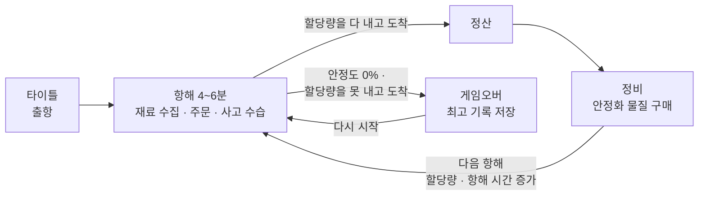

항해 동안에는 선외에서 재료를 잡아 터미널에 제출해 주문을 채우고, 받은 크레딧으로 할당량을 내거나 안정도를 회복하며, 그사이 난 사고를 수습합니다. 이 반복은 아래 '항해 안에서 되풀이하는 고리' 그림에 있습니다.

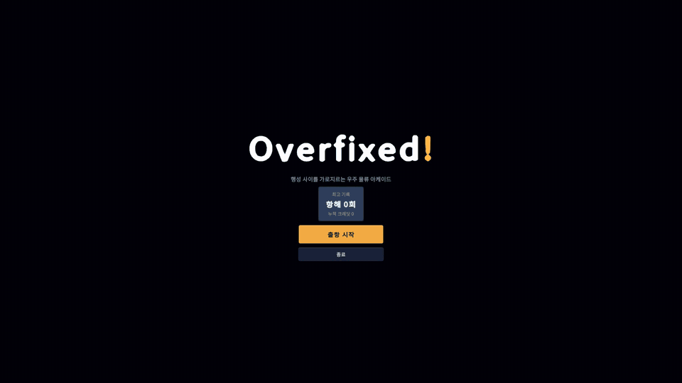

씬은 타이틀(MainMenu) · 항해(SPACE) · 정비(PLANET) 세 개입니다.

| 정산 | 정비 | 게임오버 |
|---|---|---|
|  |  |  |

세 화면이 읽는 값을 어디에 두는지는 [5.1](#51-씬을-넘는-값을-어디에-둘까)에 있습니다.

| 상황 | 입력 | 동작 |
|---|---|---|
| 선내 | WASD · Shift | 이동 (3 m/s) · 달리기 (6 m/s) |
| 선외 | WASD · Space · Ctrl · Shift | 관성 유영 (최고 5 m/s) · 상승 · 하강 · 제트 추진 (최고 10 m/s) |
| 공통 | 마우스 · E · Q · Esc | 시점 (1인칭) · 상호작용 · 든 재료 놓기 / 미니게임 닫기 · 열린 화면 닫기(없으면 일시정지) |

항해 안에서 플레이어가 되풀이하는 행동은 아래 고리입니다.

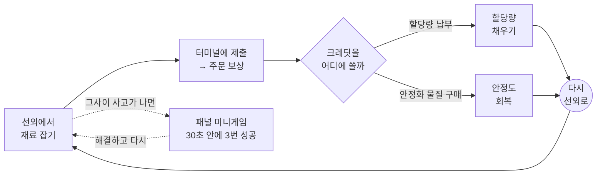

항해 중에는 "같은 크레딧을 할당량과 안정도 중 어디에 쓸지", "사고가 나면 하던 일을 멈출지"를 계속 고르게 됩니다.

항해가 거듭될수록 할당량을 늘리고(1번째 200 → 10번째 800 크레딧) 사고 간격을 줄였습니다(6.1). 같은 난이도가 반복되면 지루해지고, 쌓인 크레딧을 항해에 들어가자마자 내 버리면 선외에서 재료를 모을 이유가 부족해지기 때문입니다.

**참고한 게임.** 두 게임을 참고했습니다.

| 게임 | 참고한 점 | 이 프로젝트에서 다른 점 |
|---|---|---|
| Overcooked! | 한 번에 하나만 들고 옮기는 운반, 마감이 다른 여러 주문의 분주함 | 재료가 선외에서 흘러가다 사라지고, 직접 나가서 잡아야 한다 |
| Lethal Company | 할당량의 압박, 도착·정산 뒤 다시 출발하는 반복 | 같은 크레딧을 할당량과 안정도 회복에 나눠 써야 한다. 실패 조건이 둘(안정도 0%, 미납 도착)이다 |

| Overcooked! | Lethal Company |
|---|---|
| 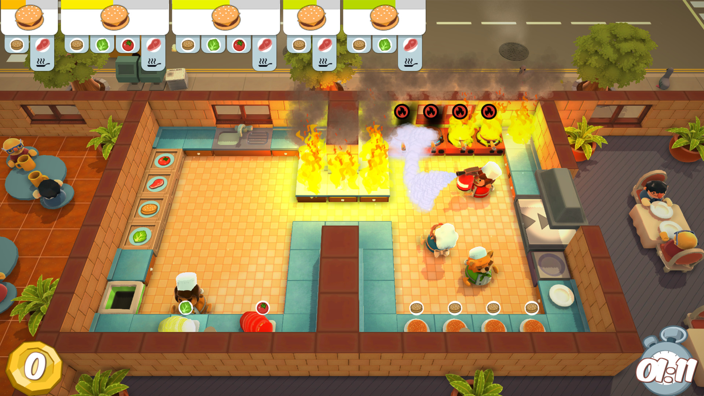 |  |

---

## 3. 전체 구조

그림에서 볼 것은 크레딧·안정도를 바꾸는 길이 모두 `GameManager`로 모인다는 점입니다.

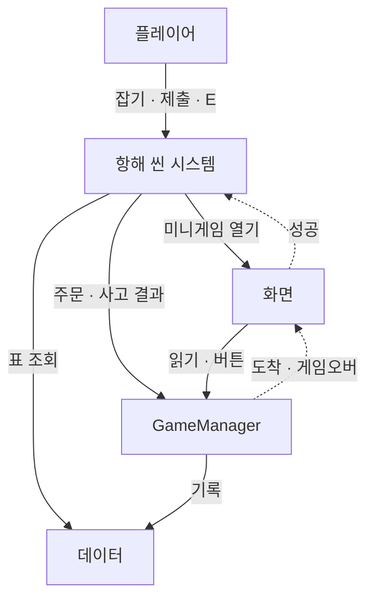

> 실선은 직접 호출, 점선은 이벤트입니다. 이벤트는 일이 일어나면 미리 등록(구독)해 둔 함수를 부르는 방식입니다.

나눈 기준은 두 가지입니다. 씬을 넘어 이어져야 하는 값은 `GameManager` 하나만 갖고, 화면은 값을 갖지 않고 읽거나 알림만 받습니다. 그래서 씬이 바뀌어도 값은 남고, 미니게임 화면을 닫아도 사고는 계속됩니다. 자세한 내용은 5.1 · 5.2 · 6.3에 있습니다.

---

## 4. 선외로 흐르는 재료


선내에만 머무는 단조로운 플레이에서 벗어나도록, 주문에 필요한 재료는 선외에서 가져와 제한시간 안에 제출하게 했습니다. 재료가 사라지게 한 것은 필요한 재료를 얻기 위한, 목적이 있는 이동을 유도하기 위해서입니다.

**재료가 흐르다 사라지게 할까?**

| | 계속 떠다니게 둔다 | 흐르다 사라지게 한다 |
|---|---|---|
| 장점 | 필요한 재료를 놓쳐도 다시 찾으러 갈 수 있어 플레이어에게 친절함 | 선내 사고와 주문 해결 사이에서 각 상황에 따른 선택을 플레이어가 스스로 결정하고, 그 과정이 긴박하게 진행됨 |
| 단점 | 놓쳐도 다시 찾을 수 있어, 무엇부터 할지 고르는 긴박함이 줄어듦 | 필요한 재료를 놓치면 다시 찾을 수 없어 덜 친절함 |

덜 친절해지는 대가를 안고 흐르다 사라지게 하는 쪽을 골랐습니다.

### 4.1 끊임없이 생기는 재료와 지붕 에어락

재료는 항해 내내 끊임없이 생겼다 사라집니다. 매번 `Instantiate`/`Destroy`(만들기 · 지우기)하면 생성 비용과 가비지(나중에 정리해야 할 메모리)가 항해 내내 반복됩니다. 그래서 미리 만들어 둔 재료를 껐다 켜며 다시 씁니다(오브젝트 풀링).

선외로 나가는 에어락은 함선 **지붕**에 있어, 재료가 아무 방향으로나 흐르면 상당수가 함선 아래나 먼 곳을 지나가 잡을 수 없습니다(→ 4.2).

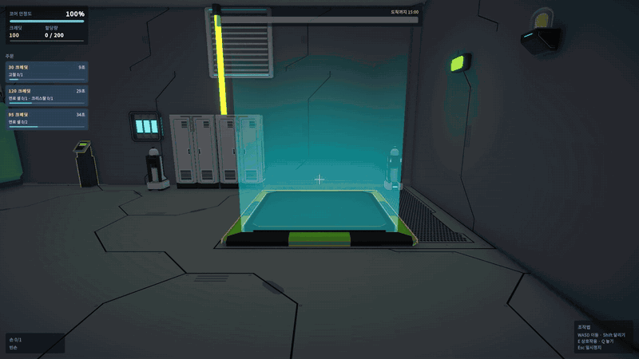

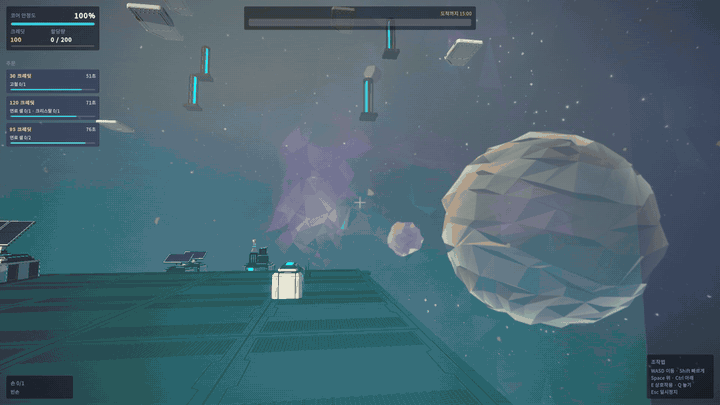

### 4.2 함선 위를 스치는 경로와 줄지 않는 풀

재료는 생성 구의 위쪽 반구에서만 출발해, 함선 구의 꼭대기를 스치는 직선으로 날아갑니다. 그래서 함선을 뚫지 않고 모두 지붕 근처를 지나갑니다.


<small>Scene 뷰에서 본 흐름 구조. 바깥 구가 생성 구(반지름 45 m), 안쪽 구가 함선 구(반지름 25 m)이고, 노란 선은 Spawn()이 만드는 경로의 예시, 흰 점이 출발점이다. 위쪽 반구에서 출발한 모든 경로가 함선 구의 꼭대기 쪽을 스쳐 지나간다</small>

이 씬에서는 두 구의 중심이 같아 **모든 경로의 길이가 약 74.8 m로 같습니다.** 그래서 흐르는 시간과 동시에 떠 있는 개수를 미리 계산해, 종류당 40개인 풀이 충분한지 확인할 수 있었습니다.

| 계산 | 값 |
|---|---|
| 경로 길이 | 약 74.8 m (모든 경로가 같음) |
| 흐르는 시간 | 74.8 m ÷ 2.5 m/s ≈ 30초 |
| 동시에 떠 있는 재료 | 초당 1.5개 × 30초 ≈ 45개 (가장 많은 고철은 약 26개) |
| 풀 크기 (`SpawnConfig`) | 종류당 40개 (3종 120개) — 고철 26개보다 많음 |

잡은 재료는 풀에 바로 반납하고, 손에는 프리팹(미리 만들어 둔 틀)에서 새로 만든 재료를 줍니다. 잡는 횟수는 생성 횟수(항해 1회 360\~540번)보다 훨씬 적어, 적은 비용으로 **"풀은 줄지 않는다"는 불변 조건**(언제나 지켜져야 하는 조건)을 구조로 지킵니다.

### 4.3 재료 종류를 드물게 하나도 뽑지 못하던 문제

재료는 종류마다 정한 비중(나머지 4종은 0)에 비례해 뽑습니다. 0부터 비중의 합(10.2) 사이에서 수 하나를 고르고, 그 수가 떨어진 칸의 재료가 나옵니다. 사고 종류도 같은 함수로 뽑습니다.

| 고철 (비중 6) | 연료 셀 (비중 3) | 크리스탈 (비중 1.2) | 끝값 |
|---|---|---|---|
| 0 \~ 6 | 6 \~ 9 ← 예: 7.5 | 9 \~ 10.2 미만 | **10.2** — 어느 칸에도 없음 |

| 항목 | 내용 |
|---|---|
| 문제 | 드물게 재료(또는 사고) 종류를 하나도 고르지 못해, 그 차례에 재료가 생기지 않았습니다 |
| 원인 | `Random.Range`에 실수를 넣으면 끝값(10.2)도 나옵니다(정수는 끝값 제외). 위 표처럼 10.2는 어느 칸에도 떨어지지 않습니다 |
| 해결 | 끝까지 못 고르면 비중이 있는 마지막 재료(크리스탈)를 돌려주고, 비중 0인 맨 뒤 4종은 건너뛰게 했습니다 |
| 결과 | 이제 늘 비중이 있는 재료 하나가 나옵니다. 플레이 중 비중이 0인 재료 4종이 한 번도 나오지 않는 것을 확인했습니다 |

- 전체 코드: [SpawnManager.cs](https://github.com/rlawlsdn77/Unity-3D-OverFixed/blob/main/Assets/OverFixed!/Scripts/SpawnManager.cs) (풀과 흐름) · [WeightedRandom.cs](https://github.com/rlawlsdn77/Unity-3D-OverFixed/blob/main/Assets/OverFixed!/Scripts/WeightedRandom.cs) (비중 뽑기)

---

## 5. 크레딧과 안정도

사고를 빨리 해결하지 않으면 안정도가 줄어듭니다([6장](#6-사고와-미니게임)). 그래서 크레딧을 안정도 회복에도 쓸 수 있게 할지 정해야 했습니다.

**크레딧을 어디에 쓰게 할까?**

| | 할당량에만 쓴다 | 할당량과 안정도 회복에 나눠 쓴다 |
|---|---|---|
| 장점 | 초반 항해의 할당량 부담을 줄일 수 있음 | 크레딧의 사용처가 늘고, 남은 크레딧을 소모할 곳이 생김 |
| 단점 | 할당량 제출이 끝나면 크레딧을 더 모아야 할 이유가 퇴색됨 | 초반 항해의 할당량 부담이 커질 수 있음 |

항해가 거듭될수록 쌓이는 크레딧을 소모할 곳이 필요해, 나눠 쓰는 쪽을 골랐습니다.

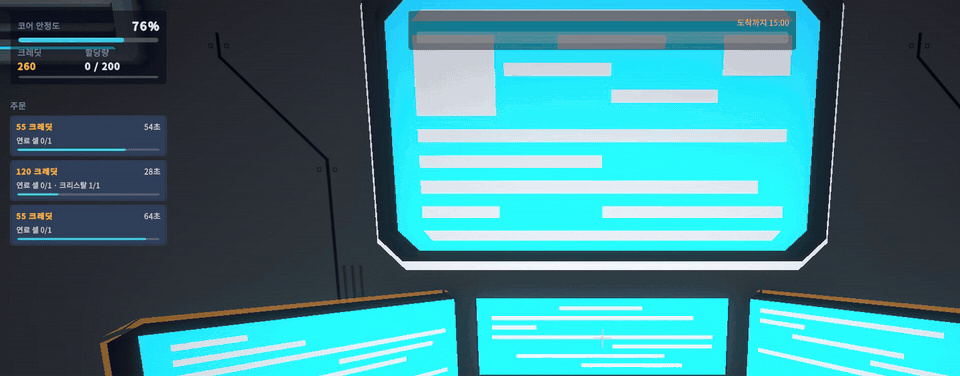

<small>터미널에서 크레딧을 나눠 쓰는 장면. 할당량 납부 탭에서 100을 내면 크레딧 260 → 160, 할당량 0 → 100 / 200이 되고, 안정화 물질 탭에서 60 크레딧에 사면 크레딧 100, 코어 안정도 76% → 86%가 된다</small>

크레딧과 코어 안정도가 늘고 주는 경우는 아래가 전부입니다.

**크레딧**

| + (늘어남) | − (줄어듦) |
|---|---|
| 주문 완료 보상 30\~120 | 할당량 납부 (터미널에서 고른 금액) |
| 도착 보상 50\~220 | 안정화 물질 구매 60 |

**코어 안정도**

| + (늘어남) | − (줄어듦) |
|---|---|
| 주문 완료 +2% | 주문 실패 −5% |
| 안정화 물질 +10% | 사고 시간 초과 −10% |
| | 매초 −0.02\~0.04% |

주문 실패에 −5%를 둔 것은, 모아 둔 크레딧으로 할당량만 내고 주문은 해결하지 않는 플레이를 막으려는 것입니다. 안정도 쪽 수치(주문 성공 회복·실패 페널티, 안정화 물질 가격·회복)는 코드가 아니라 설정 파일 `CoreConfig`에 있습니다(→ [7장](#7-데이터-구조)).

- **항해 성공**: 할당량을 다 내고 도착하면 정산 → 정비를 거쳐 다음 항해로 넘어갑니다.
- **게임오버**: 코어 안정도가 0%가 되거나, 할당량을 다 내지 못한 채 도착하면 끝납니다.

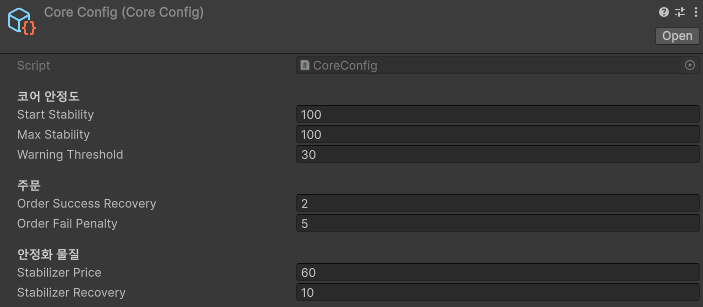

### 5.1 씬을 넘는 값을 어디에 둘까

크레딧·안정도·항해 번호는 세 씬을 오가도 이어져야 하고, 주문·사고·터미널·정산 등 8개 클래스가 이 값을 바꾸거나 씬을 넘깁니다. 값이 흩어지면 어디서 크레딧이 줄었는지 추적하기 어렵고, 0\~100% 제한과 게임오버 판정이 곳곳에 중복됩니다.

| | static 클래스 | ScriptableObject에 런타임 값 저장 | `DontDestroyOnLoad` 싱글톤 MonoBehaviour ✓ |
|---|---|---|---|
| 장점 | 가장 단순, 씬과 무관 | 씬과 무관, 인스펙터에서 값이 보임 | `Update`로 시간 진행, 설정 에셋을 인스펙터로 연결 |
| 단점 | `Update`로 시간을 진행할 수 없음 | 플레이 중 바뀐 값이 에셋에 남아 매번 초기화 필요 | 어디서든 접근해 결합도↑, 만들어지는 순서의 함정([5.3](#53-정비-씬으로-넘어가면-크레딧안정도가-처음-값으로-돌아가던-문제)) |

싱글톤(하나만 있게 만든 오브젝트)을 골랐습니다. 이 게임의 값은 보관만이 아니라 매 프레임 '진행'되어야 했습니다(안정도 감소, 도착까지 남은 시간). 대가인 결합도(한 코드가 다른 코드에 얽힌 정도)는 "값은 바깥에서 읽기만 하고, 바꾸는 길은 `GameManager` 함수뿐" 규칙으로 줄였습니다.

`GameManager` 프리팹은 3개 씬에 모두 두어 어느 씬에서 시작해도 동작하고, 두 번째부터는 중복으로 파괴됩니다. 또 배운 `SingletonBase`는 씬에 오브젝트가 없으면 새로 만들어, 정비 씬에서 `OrderManager`를 찾으면 설정이 빠진 가짜 매니저가 생깁니다. 그래서 항해 씬 밖에서는 `GameManager` 함수만 부르게 했습니다.

- 전체 코드: [GameManager.cs](https://github.com/rlawlsdn77/Unity-3D-OverFixed/blob/main/Assets/OverFixed!/Scripts/GameManager.cs)

### 5.2 값은 GameManager 함수로만 바꾸고, 화면은 읽어 간다

낼 금액은 화면(`TerminalUI`)이 고르지만, 크레딧을 실제로 빼는 일은 `GameManager`의 납부 함수(`PayQuota`)와 구매 함수(`BuyStabilizer`)만 합니다. 안정도도 아래 함수 하나로만 바뀝니다.

```csharp
// GameManager.cs (발췌)
public void ChangeStability(float amount)
{
    Stability = Mathf.Clamp(Stability + amount, 0f, coreConfig.MaxStability);
    if (IsPlaying && Stability <= 0f) GameOver(GameOverReason.StabilityZero);
}
```

초당 감소·주문·사고·구매가 모두 이 함수를 지나므로, 0\~100% 제한과 0% 게임오버 판정이 한 곳에만 있습니다. '항해 중인가' 조건 덕분에 정비 씬에서는 게임오버가 나지 않습니다.

화면이 값을 알아내는 방법은 **"그 값이 얼마나 자주 바뀌는가"** 로 나눴습니다.

| 값 | 방식 | 이유 |
|---|---|---|
| 안정도 · 남은 시간 · 주문 시간 | HUD·터미널이 매 프레임 읽음 (폴링) | 계속 변한다 |
| 도착 · 게임오버 | 이벤트로 알림 | 한 번만 일어나, 화면이 정확히 한 번 열려야 한다 |

폴링의 비용(매 프레임 문자열 생성)은 [9.4](#94-남은-문제)에 과제로 남겼습니다.

### 5.3 정비 씬으로 넘어가면 크레딧·안정도가 처음 값으로 돌아가던 문제

| 항목 | 내용 |
|---|---|
| 문제 | 정비 씬으로 넘어가면 크레딧·안정도가 처음 값으로 돌아갔습니다. 스크립트 실행 순서에 따라 `GameManager`가 씬과 함께 파괴됐습니다 |
| 원인 | 아래 그림처럼, 다른 코드가 `Awake`보다 먼저 `Instance`를 찾으면 `DontDestroyOnLoad`가 끝내 걸리지 않았습니다 |
| 해결 | `Awake`에서 자기가 하나뿐인 매니저로 정해져 있으면 `DontDestroyOnLoad`를 한 번 더 겁니다. 실행 순서를 앞당기는 방법(`[DefaultExecutionOrder]`)은 지킬 순서 규칙이 늘어나 고르지 않았습니다 |
| 결과 | 정비 씬에서도 하이어라키의 DontDestroyOnLoad 아래에 `GameManager`가 남아 있는 것을 확인했습니다 |

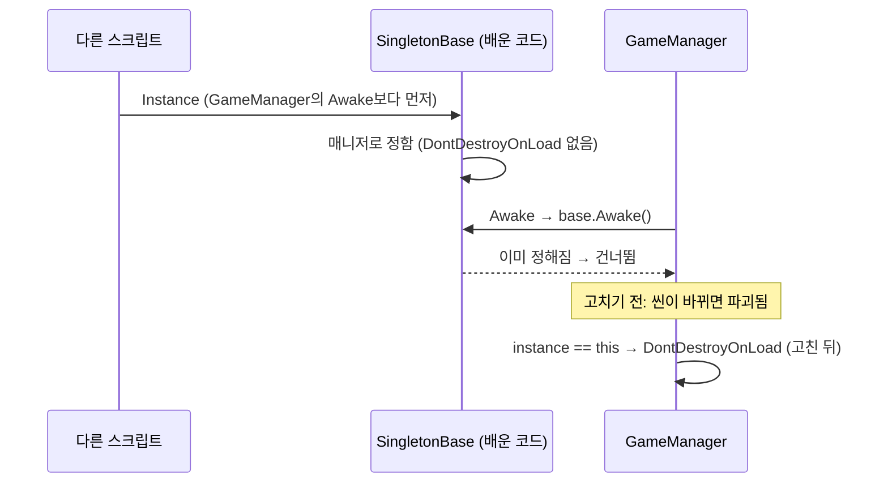

---

## 6. 사고와 미니게임


선내에서는 재료 제출 말고 할 일이 없었습니다. 그래서 선내 활동을 늘리고, 해결하지 않으면 안정도가 줄어 "상황에 따라 하나를 고르는" 선택지가 되도록 사고를 더했습니다.

### 6.1 규칙은 같고 조작은 다르다

항해 중 함선 패널 3곳 중 한 곳에 사고가 나고(한 번에 하나), 30초 안에 미니게임에서 여러 번 성공해야 해결됩니다. 미니게임 3종은 다양성을 위해 조작을 모두 다르게 했지만(Space 타이밍 / 방향키 순서 / 마우스로 전선 잇기), 규칙은 같습니다: 제한시간, **누적** 성공, 화면을 닫아도 사고·시간·성공 횟수 유지. 사고 중에도 재료를 잡으러 나갈 수 있어야 하기 때문입니다.

| 값 | 수치 | 이렇게 정한 이유 |
|---|---|---|
| 사고 간격 | 50\~80초 (10번째 항해는 30\~50초) | 익숙해져 생기는 지루함을 줄이려고 점점 짧게 |
| 해결에 필요한 성공 | 3번 (실패해도 줄지 않음) | 미니게임 시간 자체가 재료·주문을 포기하고 쓰는 시간이라, 성공 수까지 깎으면 불합리함 |
| 시간 초과 시 | 코어 안정도 −10% | 게임 이름이 OverFixed인 만큼, 방치한 페널티를 크게 |

| 타이밍 바 | 순서 입력 | 전선 잇기 |
|---|---|---|
|  |  |  |

세 화면의 위쪽(제목·남은 시간·"성공 n / 3")은 `MiniGameUI`가 함께 그리고, 가운데만 종류별 `MiniGame`이 그립니다. 그림에서 볼 것은 사고의 시간·성공 수를 패널만 갖고, 화면과 미니게임은 보여 주고 성공 1회를 알리기만 한다는 점입니다.

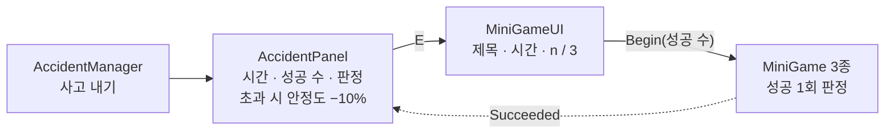

> 실선은 직접 호출, 점선은 이벤트입니다.

### 6.2 미니게임 3종의 공통 구조를 어떻게 둘까

| | 한 클래스에서 `switch (accidentType)` | 추상 클래스 `MiniGame : MonoBehaviour` |
|---|---|---|
| 장점 | 파일 하나로 끝난다 | 공통 동작은 부모에 한 번, 종류별 입력·판정만 자식에 둔다. `MiniGame[]`으로 인스펙터에 연결할 수 있다 |
| 단점 | 세 종류의 화면 참조와 상태가 한 클래스에 섞이고, 종류를 추가할 때마다 기존 코드를 고친다 | 단일 상속이라 다른 부모 클래스를 가질 수 없다 |

추상 클래스를 골랐습니다. `MiniGameUI`는 부모의 `Begin`·`End`·`Succeeded`만 알면 되므로, 종류를 추가할 때는 미니게임 클래스와 `AccidentTable` 한 줄, `AccidentType` 값 하나만 더합니다. 단일 상속 제약은 다른 부모가 필요 없어 문제가 되지 않았습니다.

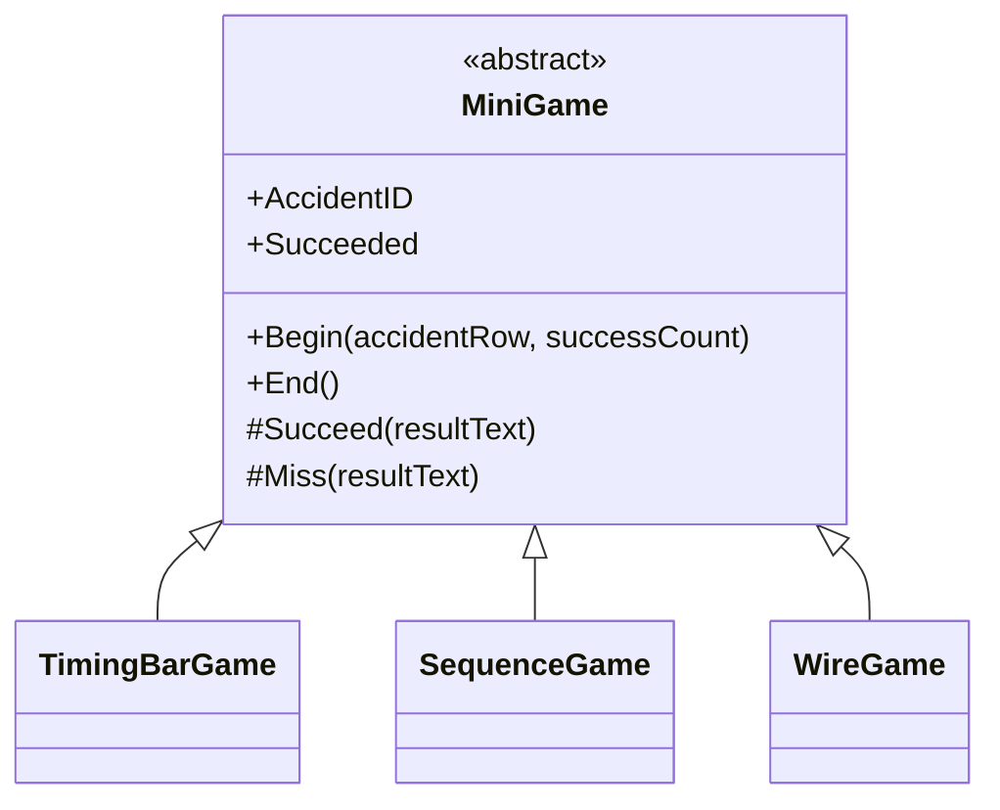

- 전체 코드: [MiniGame.cs](https://github.com/rlawlsdn77/Unity-3D-OverFixed/blob/main/Assets/OverFixed!/Scripts/MiniGame/MiniGame.cs) (공통 부모) · [WireGame.cs](https://github.com/rlawlsdn77/Unity-3D-OverFixed/blob/main/Assets/OverFixed!/Scripts/MiniGame/WireGame.cs) (전선 잇기)

### 6.3 진행 상태를 어디에 둘까

| | 미니게임 화면(`MiniGameUI`)에 | 사고가 난 패널(`AccidentPanel`)에 |
|---|---|---|
| 장점 | 화면 코드 안에서 모두 끝난다 | 화면은 보여 주기만 하므로, 닫아도 사고·시간·성공 횟수가 남는다. 시간 초과는 화면과 무관하게 패널이 처리한다 |
| 단점 | 화면을 닫으면 진행이 사라지거나, 닫힌 화면이 시간을 세야 한다. 정산·게임오버로 화면이 강제로 닫힐 때 처리가 꼬인다 | 미니게임이 성공을 직접 처리하지 못하고 이벤트로 넘겨야 해서, 구독·해제 짝을 관리해야 한다 |

패널에 두었습니다. "실패해도 성공 수는 남는다", "닫아도 사고는 계속된다"는 규칙을 주의가 아니라 구조로 보장하는 쪽입니다. 대가인 구독 관리는 **구독은 화면을 열 때(`Open`), 해제는 닫을 때(`Close`)만** 하도록 한 곳에 짝지어 해결했습니다.

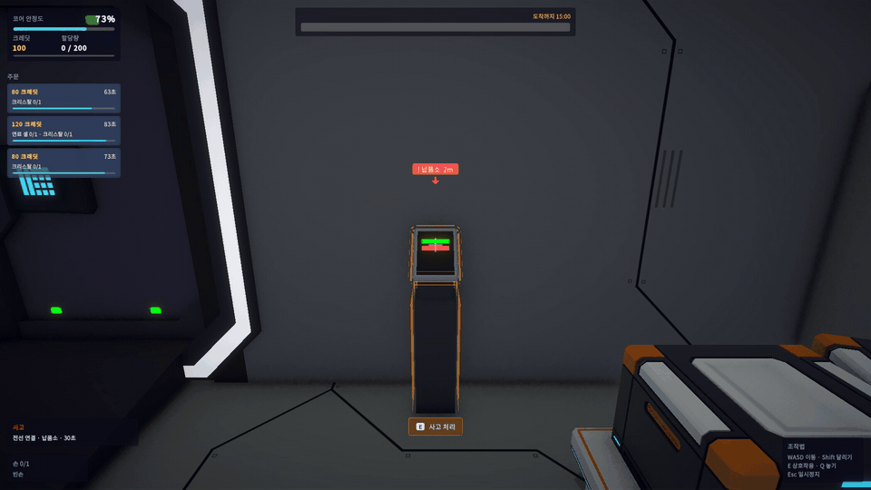

<small>전선 잇기를 닫았다 다시 여는 장면. 3쌍 중 노란 쌍을 이어 '성공 1 / 3'이 된 뒤 Q로 닫고, 패널에서 다시 E를 누르면 남은 2쌍만 나온다. 성공 수는 1 / 3 그대로이고, 남은 시간은 닫아 둔 동안에도 줄어 27초 → 24초가 된다</small>

화면을 열 때는 지금까지의 성공 수도 함께 넘겨 이어서 하게 합니다.

```csharp
// MiniGameUI.cs (발췌) — 구독은 Open에서, 해제는 Close에서만
// Open
currentMiniGame.Succeeded += accidentPanel.AddSuccess;
// Open: 지금까지의 성공 수를 넘겨 이어서
currentMiniGame.Begin(accidentRow, accidentPanel.SuccessCount);
// Close
currentMiniGame.Succeeded -= accidentPanel.AddSuccess;
```

해결, 시간 초과, 정산·게임오버 화면, Q·Esc·닫기 버튼이 모두 같은 닫기 함수를 부르므로 해제가 빠질 곳이 없습니다. 시간 초과 직후 늦게 도착한 성공처럼 어긋난 호출은 패널이 무시합니다.

- 전체 코드: [AccidentPanel.cs](https://github.com/rlawlsdn77/Unity-3D-OverFixed/blob/main/Assets/OverFixed!/Scripts/AccidentPanel.cs) (사고 상태와 판정) · [MiniGameUI.cs](https://github.com/rlawlsdn77/Unity-3D-OverFixed/blob/main/Assets/OverFixed!/Scripts/UI/MiniGameUI.cs) (열기·닫기)

---

## 7. 데이터 구조

이 장은 조작감 · 재료 생성 · 미니게임 밸런스 같은 수치를 어디에 두고 어떻게 고치는지 다룹니다.

### 7.1 누가 고치는가로 나눈 세 형식

밸런스 값은 플레이해 보며 계속 바뀝니다. 이 값이 스크립트 곳곳에 상수로 흩어져 있으면 ① 어디 있는지 찾아야 하고 ② 바꿀 때마다 컴파일하고 다시 실행해야 하며 ③ 같은 값이 두 곳에 있으면 서로 어긋납니다.

데이터를 "누가, 어떻게 고치는가"로 나눠 세 형식에 담고, **같은 데이터를 두 형식에 중복해 두지 않습니다.**

| 형식 | 담는 것 | 고치는 방법 | 이 프로젝트의 데이터 | 읽는 곳 |
|---|---|---|---|---|
| TSV (`Resources/Tsv`) | 행이 여러 개인 밸런스 표 | 스프레드시트 | `ItemTable`(재료), `OrderTable`(주문 9종), `VoyageTable`(항해 10단계), `AccidentTable`(사고 3종) | `DataManager` |
| ScriptableObject | 한 벌뿐인 조절값 | 인스펙터 (플레이 중에도) | `CoreConfig`(안정도), `SpawnConfig`(재료 생성), `PlayerControlConfig`(이동·카메라), `MiniGameConfig` 등 7종 | `[SerializeField]` 참조 |
| JSON (`persistentDataPath`) | 게임을 꺼도 남는 기록 | 게임이 저장 | `RecordSave`(최고 항해 수, 그때의 누적 크레딧) | `GameManager` |

| ScriptableObject · SpawnConfig | TSV · ItemTable |
|---|---|
| 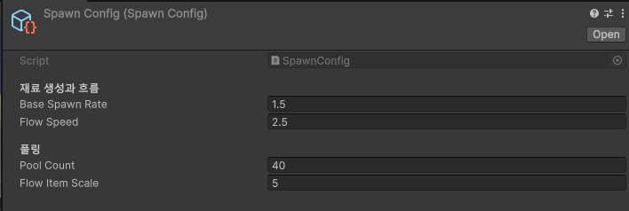 | 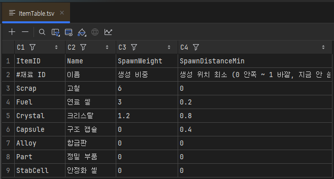 |

**한 벌뿐인 조절값은 인스펙터에서, 행이 여러 개인 밸런스 표는 스프레드시트에서 고칩니다.**

경계는 이렇게 나눕니다. 같은 재료 생성이라도 재료 전체에 **한 벌뿐인 값**(초당 생성 1.5개, 흐르는 속도 2.5 m/s, 종류당 풀 40개)은 `SpawnConfig`에, 재료 **종류마다 다른 값**(생성 비중, 생성 위치)은 `ItemTable`의 한 줄에 둡니다.

### 7.2 TSV 표 규칙

처음엔 CSV였지만, 한글 이름·설명의 쉼표 하나가 열을 밀어 버려 다음 날 TSV로 바꿨습니다. 따옴표 규칙을 처리하는 대신 **구분자를 문장에 나오지 않는 탭으로 바꿔** 파서(표 글을 읽어 데이터로 바꾸는 코드)를 단순하게 두었고, 대가는 Unity가 `.tsv`를 읽게 하는 10줄짜리 임포터 하나였습니다.

`AccidentTable` (설명 열 생략)

| AccidentID | Name | TimeLimit | SuccessCount | StabilityPenalty | SpawnWeight |
|---|---|---|---|---|---|
| #사고 ID | 이름 | 제한시간 (초) | 해결에 필요한 성공 횟수 (누적) | 시간 초과 시 코어 안정도 감소 (%) | 사고 종류를 뽑는 비중 |
| TimingBar | 패널 수리 | 30 | 3 | 10 | 1 |
| Sequence | 회로 재입력 | 30 | 3 | 10 | 1 |
| Wire | 전선 연결 | 30 | 3 | 10 | 1 |

- **첫 줄** 영어 열 이름 = 코드가 칸을 찾는 키. 한글 열 이름은 엑셀 CP949 저장·띄어쓰기 차이로 키가 깨집니다.
- **둘째 줄** `#` 한글 설명 = 사람이 읽는 줄. 파서는 `StartsWith("#")` 하나로 건너뜁니다.
- **ID 값**은 C# enum 이름과 같습니다(`TimingBar` ↔ `AccidentType.TimingBar`).

### 7.3 읽는 코드 하나로 모든 표를 읽는다

그림에서 볼 것은 표마다 다른 곳이 '행 클래스의 `FromCells`' 한 칸뿐이고, 나머지 흐름은 모든 표가 함께 쓴다는 점입니다.

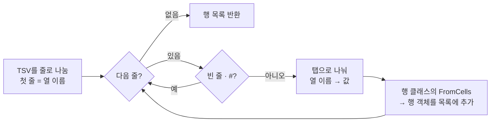

새 표는 TSV 파일·행 클래스(`FromCells`)·`DataManager` 조회 함수만 더하면 되고, 파서는 고치지 않습니다.

- 칸을 **열 번호가 아니라 열 이름으로** 찾습니다. 표에 열을 추가하거나 순서를 바꿔도 기존 코드가 깨지지 않습니다.
- 한 줄을 행 객체로 바꾸는 방법은 함수로 넘겨받습니다(제네릭). 파서 하나가 모든 표에 쓰입니다.
- `DataManager`는 static 클래스라 씬에 오브젝트를 둘 필요도, 초기화 순서를 맞출 필요도 없습니다. 처음 조회할 때 한 번 읽어 두고 다시 씁니다(캐시).
- ID는 문자열 대신 enum(정해진 값 목록)으로 두었습니다. TSV에 `Timingbar` 같은 오타가 있으면 표를 처음 읽을 때 바로 오류로 드러납니다. 대신 enum 선언 순서를 바꾸면 프리팹이 다른 재료를 가리키게 됩니다. 그래서 '새 값은 항상 맨 뒤에 추가한다'는 규칙을 enum 선언 위 주석으로 남겼습니다.

- 전체 코드: [DataManager.cs](https://github.com/rlawlsdn77/Unity-3D-OverFixed/blob/main/Assets/OverFixed!/Scripts/Data/DataManager.cs) · [TsvParser.cs](https://github.com/rlawlsdn77/Unity-3D-OverFixed/blob/main/Assets/OverFixed!/Scripts/Data/TsvParser.cs) · [TsvImporter.cs](https://github.com/rlawlsdn77/Unity-3D-OverFixed/blob/main/Assets/OverFixed!/Scripts/Editor/TsvImporter.cs)

---

## 8. 나머지 기능

깊게 다룬 기능 외에는 한 줄씩 정리합니다.

| 기능 | 요점 |
|---|---|
| 선내 / 선외 이동 | 선내는 중력과 평면 이동, 선외는 관성 유영 |
| 에어락 | 0.5초 동안 진행 막대를 채운 뒤 선내 ↔ 지붕으로 옮긴다 |
| 상호작용 | 가장 가까운 대상을 고르고, 지금 못 하면 이유("손이 찼음")를 흐리게 보인다 |
| 주문 보드 | 제출한 재료는 남은 시간이 가장 짧은 주문에 자동 배정 (아래 GIF) |
| 1인칭 로봇 애니메이션 | 이동 속도에 맞춰 걷기·뛰기를 섞고, 재료를 들면 두 손이 쥔다 |
| 사고 위치 표시 | 화면 밖이면 가장자리 화살표로 방향을 가리킨다 |
| Esc 처리 | `PauseUI` 한 곳에서만 받아, 한 번 눌러 두 화면이 반응하지 않게 한다 |

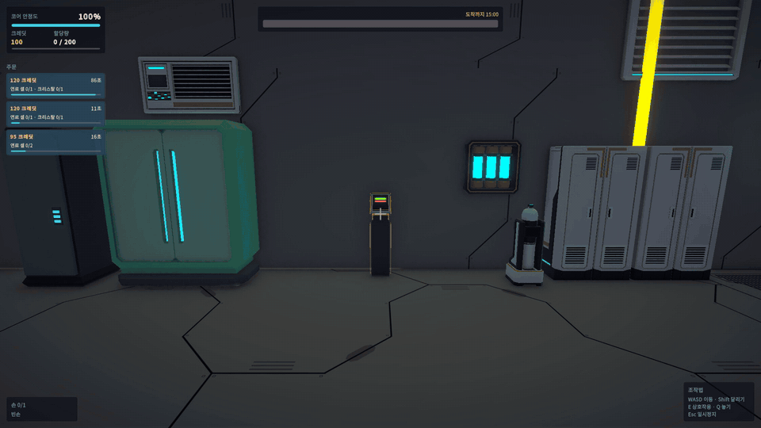

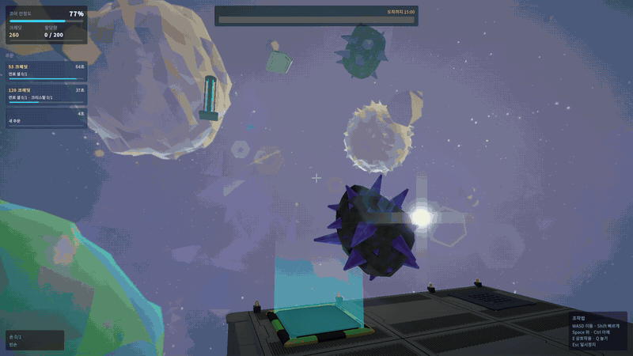

---

## 9. 돌아보며

### 9.1 목표한 경험은 전해졌나

한 판(타이틀 → 항해 → 정산 → 정비 → 다음 항해, 게임오버·최고 기록)은 목표대로 2주 안에 끝까지 돌게 만들었습니다.

수업 피드백 응답 12개를 비슷한 의견끼리 묶었습니다(한 응답에 여러 의견이 있으면 여러 묶음에 셈).

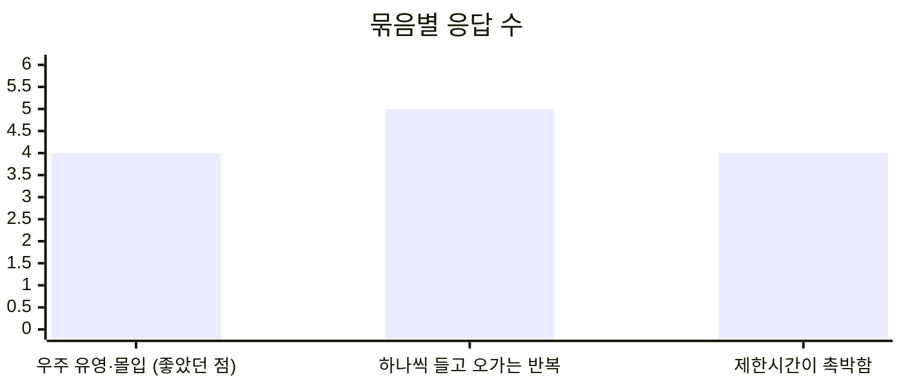

> **우주 유영·몰입** — "우주 유영을 하는 감각은 재밌었습니다." / "…물품 배달 + 기지의 고장 + 금액 할당량 이 합쳐져서 게임 몰입감이 좋았다."
>
> **하나씩 들고 오가는 반복** — "물체를 하나 잡고 일일이 가져와야 한다는 점이 너무 아쉬웠습니다."
>
> **제한시간이 촉박함** — "개인적으로 제한 시간이 좀 각박한 것 같았고, 시간은 좀 널널한 대신 여러 방해 요소를 배치하는 방식이 되면 더 좋을 듯 함."

몰입감이 좋았다는 반응으로 보아 목표한 경험은 생겼다고 봅니다. 그러나 가장 많은 응답(5건)은 하나씩 들고 오가는 반복이 답답하다는 것이었습니다. Overcooked!를 임시로 따라간 '한 번에 하나만 들기'가 부족했고, 이 반복이 의도한 촉박함과 겹쳐 제한시간이 각박하다는 반응(4건)으로 이어졌습니다. 다음에는 한 번에 여러 개를 들게 하고, 제한시간을 늘리는 대신 방해 요소를 더하겠습니다.

### 9.2 기준을 먼저, 규칙은 구조로

개인 목표였던 데이터와 기능의 분리는 능률을 올렸습니다. 재료의 스폰 비중, 주문 크레딧 보상, 이동속도 등 수치화된 데이터를 코드를 건드리지 않고 쉽게 바꿀 수 있어서 레벨 디자인이 쉬웠습니다.

- 판단 기준을 먼저 세우면 선택이 빨라진다. 데이터 형식은 "누가 어떻게 고치는가", 화면 갱신은 "값이 얼마나 자주 바뀌는가", 상태의 위치는 "화면이 닫혀도 남아야 하는가"로 정했습니다. 기준이 있으니 비슷한 고민이 다시 나와도 같은 답을 낼 수 있었습니다.
- 불변 조건은 주의가 아니라 구조로 지킨다. "값은 `GameManager` 함수로만 바뀐다"(바깥에서는 읽기만), "풀은 줄지 않는다"(잡으면 교체), "닫아도 사고는 계속된다"(상태는 패널에)를 코드 구조로 강제했습니다.
- 쓰는 도구의 실제 동작을 확인한다. 5.3 · 4.3과 아래 두 버그는 모두 '안다고 생각한 동작'과 실제 동작의 차이에서 나왔습니다.

| 문제 | 원인 → 해결 |
|---|---|
| 안정도가 "100%"로 보이는데 안정화 물질을 살 수 있었다(60 크레딧에 +0.02%) | 화면은 99.98%를 올려 보이고, 버튼은 실제 값으로 판단 → '가득 참'도 올린 값(`Mathf.CeilToInt`)으로 판단 |
| 전선 잇기를 열자마자 누르면 전선이 엉뚱한 곳에서 시작했다 | Layout Group은 위치를 프레임 끝에 계산 → 단자를 만든 직후 `LayoutRebuilder.ForceRebuildLayoutImmediate`로 바로 계산 |

### 9.3 AI와 함께 만든 방식

| AI에게 맡긴 것 | 내가 직접 판단한 것 |
|---|---|
| 셰이더 | 셰이더 모양 |
| 재료 스폰 경로 (함선 구를 비껴 지나가기) | 위쪽 반구·함선 위 스치기 ([4.2](#42-함선-위를-스치는-경로와-줄지-않는-풀)) |
| 코드 리팩터링 | 리팩터링 규칙(아래 두 규칙) |

**확인 방법.** 셰이더는 게임 화면에서 눈으로, 스폰 경로는 플레이와 경로 길이 계산으로, 리팩터링은 한 판 플레이로 확인했습니다.

**잘 된 것.**
- 셰이더와 경로 초안을 빨리 얻었습니다.

**안 된 것.**
- 스폰 경로를 요청했을 때 AI가 함선 구를 무시한 경로를 줘서, 재료가 우주선에 충돌하거나 뚫고 지나가는 버그가 생겼습니다. 플레이로 확인한 뒤 다시 검수를 요청해 바꿨습니다.
- 다시 받은 경로도 그대로 쓰지 않았습니다. AI가 만든 재료 스폰 경로는 함선 구의 전체를 스치는 형태였지만, 플레이 테스트 시 밑에서 지나가는 재료는 접근성이 좋지 않아 함선 구의 위쪽 부분만 스폰 경로로 지정되도록 바꿨습니다.

AI에게는 두 규칙을 걸었습니다.

- **값은 `GameManager` 함수로만 바꾼다** — 값이 여러 곳에 흩어지면 추적이 어렵고 판정이 중복됨 (5.1)
- **데이터와 기능을 분리한다** — 수치가 곳곳에 상수로 흩어지면 찾기 어렵고, 바꿀 때마다 컴파일하며, 두 곳에서 어긋남 (7.1)

### 9.4 남은 문제

| 아쉬운 점 (기술 부채) | 왜 문제인가 | 향후 계획 (To-Be) |
|---|---|---|
| 상호작용 규칙이 두 곳에 있다 | 대상이 늘 때마다 같은 분기를 두 곳에서 고쳐야 한다 | 대상이 `IInteractable`을 직접 구현해 한 곳에 모은다 |
| Q를 두 곳에서 받는다 | 재료를 든 채 미니게임을 Q로 닫으면 재료까지 놓일 수 있다 | Esc처럼 한 곳에서 받는다 |
| HUD·터미널이 매 프레임 문자열을 새로 만든다 | 값이 그대로여도 매 프레임 할당이 생긴다 | 값이 바뀔 때만 갱신하고, 프로파일러로 전후를 측정한다 |
| 오브젝트 풀링의 효과를 수치로 재지 않았다 | 개선 폭(GC 할당, 프레임 시간)을 말할 수 없다 | 프로파일러로 `Instantiate`/`Destroy` 방식과 비교한다 |
